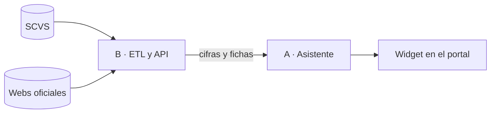

# Observatorio EPN

Directorio de empresas ecuatorianas con datos abiertos y un asistente conversacional. Las cifras salen de la Superintendencia de Compañías (SCVS) y el texto de las fichas, de las webs oficiales de cada empresa.

El proyecto tiene dos componentes que se comunican por API:

| Componente | Qué hace | Carpetas |
| --- | --- | --- |
| A · Asistente | Responde preguntas sobre las empresas con cita de la fuente | `rag/`, `widget/` |
| B · Datos abiertos | Carga y limpia los datos, publica la API y el portal | `etl/`, `api/`, `portal-datos/` |

## Estructura

| Carpeta | Contenido |
| --- | --- |
| `docs/` | Documentación compartida y decisiones (ADR) |
| `contracts/` | Contrato OpenAPI entre A y B |
| `infra/` | Base de datos y despliegue |
| `etl/` | Datos crudos, selección del universo y ETL |
| `api/`, `portal-datos/` | API pública y portal de B |
| `rag/`, `widget/` | Asistente y widget de A |

## Documentación

- [Arquitectura](docs/arquitectura.md)
- [Universo de empresas](docs/universo.md)
- [Justificación del universo](docs/justificacion-universo.md)
- [Ficha de empresa](docs/ficha-empresa.md)
- [Infraestructura](docs/infraestructura.md)
- [Decisiones (ADR)](docs/adr/README.md)
