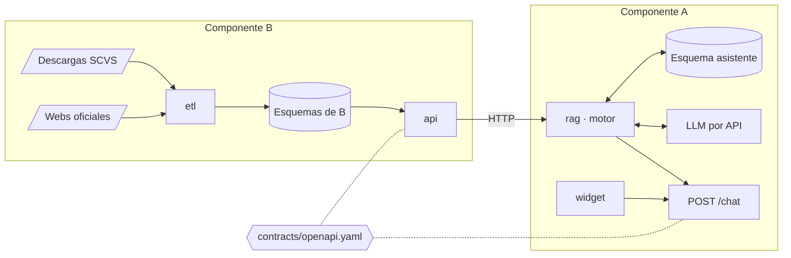

# Arquitectura

B publica cifras y fichas por API. A las consume por HTTP y nunca lee la base de B. Los dos componentes viven en un solo repositorio ([ADR 0001](adr/0001-monorepo.md)).

## Frontera entre A y B

| Regla | Cómo se cumple |
| --- | --- |
| A no lee los datos de B | Un rol de PostgreSQL por componente ([ADR 0002](adr/0002-postgresql-esquemas-roles.md)) |
| Toda cifra que muestra A viene de la API de B | El índice de A no guarda cifras |
| El contrato se escribe antes que el código | `contracts/openapi.yaml` ([ADR 0003](adr/0003-contrato-primero.md)) |
| Un solo recolector web | B captura las webs; A indexa lo que B expone ([ADR 0006](adr/0006-bloque2-company-profile-en-b.md)) |

## Rutas del contrato

| Ruta | Implementa | Consume |
| --- | --- | --- |
| `GET /empresas` | B | A |
| `GET /empresas/{expediente}` | B | A |
| `GET /empresas/{expediente}/documentos` | B | A |
| `GET /indicadores` | B | A |
| `POST /chat` | A | widget |

## Dueños

| Carpeta | Dueño |
| --- | --- |
| `etl/`, `api/`, `portal-datos/` | B |
| `rag/`, `widget/` | A |
| `docs/`, `contracts/`, `infra/`, raíz | Compartido: un cambio requiere la revisión del otro estudiante |

## Stack

| Ámbito | Herramienta |
| --- | --- |
| Lenguaje | Python 3.12 |
| Paquetes | uv |
| API | FastAPI |
| Base de datos | PostgreSQL 16 + pgvector |
| Pruebas y lint | pytest, ruff |
| Contrato | OpenAPI 3.1 |
| Widget | React + TypeScript, alineado con FragUI |
| Despliegue | Docker Compose ([infraestructura](infraestructura.md)) |
