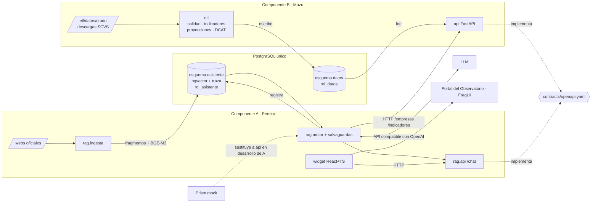

# Arquitectura del monorepo

El repositorio reúne dos componentes con una frontera explícita: B publica cifras por API y A las consume por HTTP. A nunca accede al esquema de B.

## Módulos y comunicación

## Dueños

| Carpeta | Dueño |
| --- | --- |
| `etl/`, `api/`, `portal-datos/`, `docs/sprints/B`, `docs/evidencias/B` | B (Eduardo Muzo) |
| `rag/`, `widget/`, `docs/sprints/A`, `docs/evidencias/A`, `docs/evaluacion/` | A (Alicia Pereira) |
| `contracts/`, `infra/`, `scripts/`, `.github/`, `docker-compose.yml`, `.env.example`, `docs/adr/`, `docs/arquitectura/`, `docs/investigacion/`, raíz | Compartido |

| Regla para lo compartido | Mecanismo |
| --- | --- |
| Todo cambio requiere la aprobación del otro estudiante | `CODEOWNERS` + "Require review from Code Owners" |
| En el módulo propio se fusiona con la CI en verde | Rutas sin dueño en `CODEOWNERS`; 0 aprobaciones requeridas |
| Un cambio incompatible del contrato exige ADR y versión mayor | Plantilla de issue `cambio-contrato` |
| A no lee `datos` | Roles de PostgreSQL (`infra/postgres/init/`) |

## Stack por carpeta

| Carpeta | Lenguaje / framework | Paquetes | Pruebas | Lint | Alternativa descartada |
| --- | --- | --- | --- | --- | --- |
| `etl/` | Python 3.12, SQLAlchemy Core, Alembic | uv | pytest | ruff | Airflow/dbt: sobredimensionado |
| `api/` | Python 3.12, FastAPI | uv | pytest + TestClient | ruff | Django REST: más capas |
| `rag/` | Python 3.12, FastAPI, LlamaIndex, pgvector | uv | pytest | ruff | LangChain; Chroma/Qdrant |
| `widget/` | React 19 + TypeScript, tsup, Storybook 10 | npm | Vitest + axe-core, Chromatic | ESLint 9 + Prettier | pnpm o Lit (divergen de FragUI) |
| `contracts/` | OpenAPI 3.1 | npx | Spectral | Spectral | Contrato generado desde código |
| `scripts/` | Windows PowerShell 5.1 (compatible con pwsh 7) | — | Misma ejecución en la CI | PSScriptAnalyzer | Makefile (no nativo en Windows) |
| CI | GitHub Actions + dorny/paths-filter | — | — | — | Un workflow por módulo |

Las decisiones se justifican en [`../adr/`](../adr/README.md). Lo que sigue abierto está en [pendientes.md](pendientes.md).
