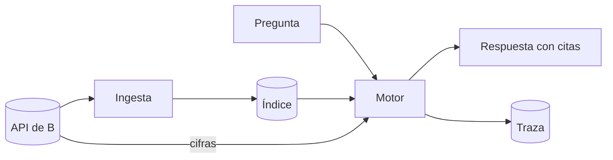

# Componente A · Asistente

Asistente conversacional que responde preguntas sobre las empresas del Observatorio y cita la fuente de cada dato. Atiende dos tipos de consulta: sobre una empresa concreta ("¿qué hace Telconet?") y de directorio ("¿qué empresas desarrollan software en Cuenca?"). Se usa desde un widget embebido en el portal, sin registro.

## Estado

| Sprint | Objetivo | Estado |
| --- | --- | --- |
| 1 | Investigación, arquitectura, corpus y protocolo de evaluación | Falta correr la comparación de LLM |
| 2 | Ingesta, fragmentación e índice | Hecho; BGE-M3 adoptado de forma provisional; 54 fichas del Company Profile indexadas |
| 3 | Motor RAG con citación y API `/chat` | Pendiente |
| 4 | Widget | Pendiente |
| 5 | Salvaguardas | Pendiente |
| 6 | Integración con la API de B | Pendiente |
| 7 | Evaluación con al menos 30 usuarios | Pendiente |
| 8 | Despliegue | Pendiente |
| 9 | Memoria del TIC | Pendiente |

## Documentos

| Documento | Contenido |
| --- | --- |
| [casos-de-uso.md](casos-de-uso.md) | Quién usa el asistente y para qué |
| [asistente.md](asistente.md) | Cómo funciona el asistente y sus reglas |
| [protocolo-evaluacion.md](protocolo-evaluacion.md) | Cómo se evalúa: preguntas, métricas, usuarios y carga |
| [evaluacion.md](evaluacion.md) | Resultados y comparación de LLM |
| [comparacion-embeddings.md](comparacion-embeddings.md) | Léxico, MiniLM y BGE-M3 con las 50 preguntas |
| [estado-del-arte.md](estado-del-arte.md) | Literatura que sostiene el diseño |
| [herramientas.md](herramientas.md) | Stack del componente |
| [plan.md](plan.md) | Pendientes por sprint y dependencias con B |
| [evidencias.md](evidencias.md) | Registro de evidencias `EV-A` |

Lo compartido con B (universo, ficha, arquitectura, infraestructura) está en [`docs/`](../README.md).
