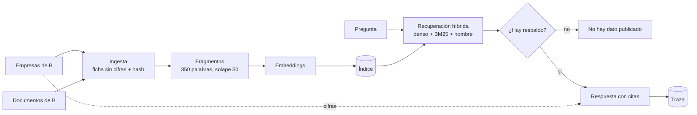

# Cómo funciona el asistente

El asistente recupera fragmentos del índice, verifica que respalden la pregunta y responde citando cada fuente. Las cifras no salen del índice: se piden a la API de B al momento de responder.



## Etapas

| Etapa | Qué hace | Código |
| --- | --- | --- |
| Cliente de B | Lee empresas y documentos de B; hoy usa `piloto_500.csv` con la forma de `GET /empresas` | `rag/src/rag/cliente_b` |
| Ingesta | Arma una ficha de texto por empresa, sin cifras, y guarda fuente, fecha y hash | `rag/src/rag/ingesta` |
| Índice | Fragmenta, calcula embeddings y guarda los vectores | `rag/src/rag/indice` |
| Pipeline | Ejecuta la ingesta solo sobre lo que cambió (por hash) | `rag/src/rag/pipeline.py` |
| Motor | Combina búsqueda densa, BM25 y nombre de empresa con RRF; aplica la salvaguarda y arma la respuesta | `rag/src/rag/motor` |
| Almacén | Archivos o tabla `asistente.fragmento` con índice HNSW | `rag/src/rag/indice`, `rag/migraciones/001_asistente.sql` |
| Traza | Registra pregunta, fragmentos, fuentes, modelo, tokens y latencia | Tabla `asistente.traza` o `rag/datos/trazas.jsonl` |

## Reglas de respuesta

| Regla | Cómo se aplica |
| --- | --- |
| Toda afirmación lleva cita | Cada fuente muestra empresa, URL y fecha de corte. Si el LLM responde sin citas válidas, la respuesta se descarta |
| Sin respaldo, no hay respuesta | Coseno ≥ 0,65, o coseno ≥ 0,30 con coincidencia léxica. Si no se cumple: "No hay dato publicado" |
| Campo pedido con fuente | Si la pregunta pide misión, historia, directivos, contacto, certificaciones o productos y ningún fragmento lo contiene: "No hay dato publicado" |
| Las cifras vienen de B | Ventas y empleados se piden a B al responder |
| Empleados con advertencia | Si la empresa tiene `alerta_empleados`, la respuesta lo advierte |
| Texto marcado por origen | `literal` si se copió de la fuente, `derivado` si se redactó a partir de ella |

## Ejemplo

```text
$ python -m rag consulta "¿Cuánto vendió Tiendas Tuti y cuántos empleados tiene?"
- TIENDAS TUTI TTDE S.A.: Venta al por menor ... en supermercados (Guayaquil) [1].
  Ventas 2025: USD 1.008.144.377,94; empleados declarados: 8

Fuentes:
  [1] TIENDAS TUTI TTDE S.A. · scvs_ranking · corte 2026-10-22

Advertencia: declara 8 empleados con ventas de USD 1.008.144.377,94;
el dato de empleados de la SCVS es inconsistente en este caso.
```

## Uso

```powershell
$env:PYTHONPATH = "rag/src"
python -m rag ingesta                  # --reconstruir para empezar de cero
python -m rag consulta "¿Qué empresas ofrecen medicina prepagada?"
python -m rag evaluar --salida rag/evidencias/eval.json
python -m rag comparar-llm --salida rag/evidencias/llm
```

Con PostgreSQL:

```powershell
$env:RAG_ALMACEN = "pgvector"
$env:RAG_PG_DSN = "host=localhost dbname=observatorio user=rol_asistente password=..."
python -m rag ingesta
```

La base necesita la extensión `vector`, que instala un administrador con `CREATE EXTENSION vector;`.

| Variable | Defecto | Uso |
| --- | --- | --- |
| `RAG_EMBEDDINGS` | `paraphrase-multilingual-MiniLM-L12-v2` | Modelo de embeddings; `BAAI/bge-m3` en producción |
| `RAG_UMBRAL_SIMILITUD`, `RAG_UMBRAL_FUERTE` | 0,30 / 0,65 | Umbrales de respaldo |
| `RAG_TOP_K` | 5 | Fragmentos por respuesta |
| `RAG_ALMACEN`, `RAG_PG_DSN` | `archivos`, vacío | Almacén del índice |
| `RAG_LLM_BASE_URL`, `RAG_LLM_MODELO`, `RAG_LLM_API_KEY` | vacío | Activan la generación con LLM; sin ellos la respuesta es extractiva |

## Diferencias entre el prototipo y la versión final

| Prototipo | Versión final |
| --- | --- |
| MiniLM multilingüe (384 dimensiones) | BGE-M3 (1.024 dimensiones) |
| Empresas desde `piloto_500.csv` | API de B |
| Solo la descripción CIIU de cada empresa | Documentos del Company Profile |
| Respuesta extractiva | LLM elegido en la comparación |
