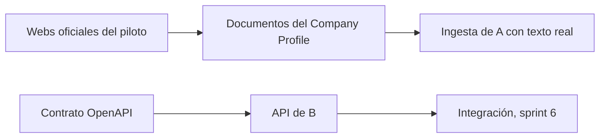

# Plan

## Sprint 1 · Investigación, corpus y protocolo

| Entregable | Estado |
| --- | --- |
| Casos de uso | Hecho: [casos-de-uso.md](casos-de-uso.md) |
| Protocolo de evaluación con 50 preguntas, métricas y SUS | Hecho: [protocolo-evaluacion.md](protocolo-evaluacion.md) |
| Revisión bibliográfica | Hecho: [estado-del-arte.md](estado-del-arte.md); falta pasarla a Zotero |
| Comparación de LLM | Script listo; falta correrlo con las claves de cada proveedor |
| Borrador del contrato con B | Hecho: [`contracts/openapi.yaml`](../../contracts/openapi.yaml), por revisar con B |

## Sprint 2 · Ingesta e índice

| Entregable | Estado |
| --- | --- |
| Ingesta idempotente, fragmentación y recuperación híbrida | Hecho |
| Índice en pgvector con HNSW y trazas en tabla | Hecho |
| uv y CI | Hecho: `rag/uv.lock` y `.github/workflows/rag.yml` |
| BGE-M3 y recalibración de umbrales | Falta: correr en un equipo con acceso a Hugging Face |

## Dependencias con B

| Qué necesita A | Estado |
| --- | --- |
| Revisión del contrato OpenAPI | Pendiente con B |
| Webs oficiales verificadas del piloto | Plazo por coordinar |
| Documentos en `GET /empresas/{expediente}/documentos` | Después de las webs |
| API de B | Sprint 6 |

Mientras tanto, A trabaja con `piloto_500.csv` y con un servidor simulado del contrato.

## Integración con el portal

La reunión con el equipo del portal está por coordinar. Preguntas para esa reunión:

| Pregunta | Por qué importa |
| --- | --- |
| Framework y versión de React | Compatibilidad del widget |
| ¿Usa FragUI como dependencia? | Reutilizar componentes |
| Dominio y autenticación | CORS y sesión |
| ¿Dónde se despliega `/chat`? | Configuración final |
