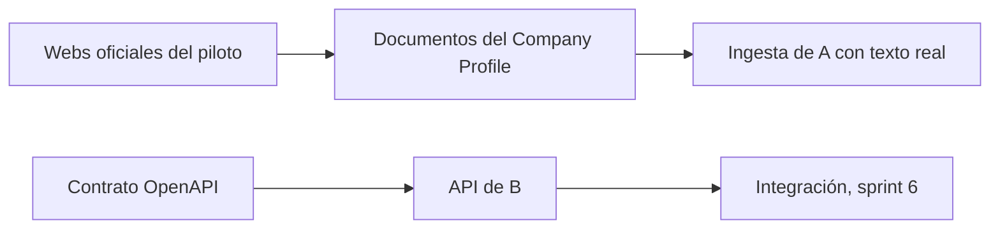

# Plan

## Sprint 1 · por cerrar

| Pendiente | Entregable |
| --- | --- |
| Revisión bibliográfica de RAG (últimos cinco años, más obras seminales) | Capítulo 2 de la memoria |
| Casos de uso del asistente | Lista de casos a partir de las 30 preguntas del prototipo |
| Protocolo de evaluación: 50 preguntas, métricas y SUS | `rag/evaluacion/` |
| Comparación de LLM | Resultados y ADR del modelo elegido ([evaluación](evaluacion.md#comparación-de-llm)) |
| Borrador del contrato con B | `contracts/openapi.yaml` |

## Sprint 2 · completar el prototipo

| Pendiente | Motivo |
| --- | --- |
| Pasar el índice a pgvector | El prototipo guarda el índice en archivos |
| Cambiar a BGE-M3 y recalibrar los umbrales | Es el modelo previsto; corrige parte de H2 y H3 |
| Configurar uv y la CI | Pruebas automáticas en cada PR |

## Dependencias con B

| Qué necesita A | Estado |
| --- | --- |
| Webs oficiales verificadas del piloto | Plazo por coordinar |
| Documentos en `GET /empresas/{expediente}/documentos` | Después de las webs |
| API de B | Sprint 6 |

Mientras tanto, A trabaja con `piloto_500.csv` y con un servidor simulado del contrato.

## Integración con el portal

La reunión con el equipo del portal está por coordinar. Preguntas para esa reunión:

| Pregunta | Por qué importa |
| --- | --- |
| Framework y versión de React | Compatibilidad del widget |
| ¿Usa FragUI como dependencia? | Reutilizar componentes |
| Dominio y autenticación | CORS y sesión |
| ¿Dónde se despliega `/chat`? | Configuración final |
