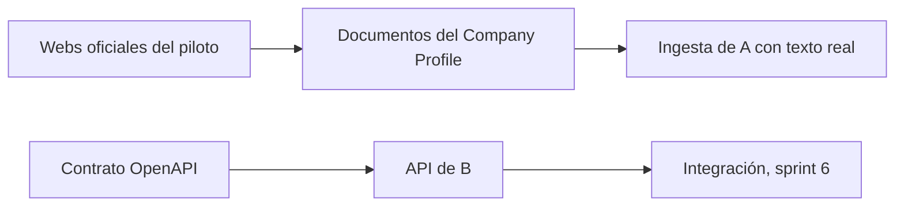

# Plan

## Sprint 1 · Investigación, corpus y protocolo

| Entregable | Estado |
| --- | --- |
| Casos de uso | Hecho: [casos-de-uso.md](casos-de-uso.md) |
| Protocolo de evaluación con 50 preguntas, métricas y SUS | Hecho: [protocolo-evaluacion.md](protocolo-evaluacion.md) |
| Revisión bibliográfica | Hecho: [estado-del-arte.md](estado-del-arte.md); falta pasarla a Zotero |
| Casos de uso del actor Gobierno | Hecho: CU-08 y CU-09 en [casos-de-uso.md](casos-de-uso.md) |
| Comparación de LLM | Primera ronda hecha: GPT-6 Luna, candidato provisional ([evaluacion.md](evaluacion.md#primera-ronda-24-nov-2026)). Falta RAGAS, la revisión manual y repetir la corrida |
| Borrador del contrato con B | Hecho: [`contracts/openapi.yaml`](../../contracts/openapi.yaml), por revisar con B |

## Sprint 2 · Ingesta e índice

| Entregable | Estado |
| --- | --- |
| Ingesta idempotente, fragmentación y recuperación híbrida | Hecho |
| Índice en pgvector con HNSW y trazas en tabla | Hecho |
| uv y CI | Hecho: `rag/uv.lock` y `.github/workflows/rag.yml` |
| BGE-M3 y recalibración de umbrales | Hecho: [comparacion-embeddings.md](comparacion-embeddings.md) |
| Fichas del Company Profile en el índice | Hecho con las 54 fichas no pendientes de B: [evaluacion.md](evaluacion.md#con-el-company-profile) |
| Cliente HTTP de la API de B | Hecho: `RAG_FUENTE_B=http` |

## Sprint 3 · Motor RAG

| Entregable | Estado |
| --- | --- |
| Conteos por sector y territorio (CU-08) | Pendiente: con `total` de `GET /v1/empresas` |
| Series por empresa (CU-09) | Pendiente: con `cifras` de `GET /v1/empresas/{expediente}` |
| Preguntas de referencia `perfil`, `agregado` y `serie` | Pendiente |

## Dependencias con B

| Qué necesita A | Estado |
| --- | --- |
| Revisión del contrato OpenAPI | Pendiente con B: la API usa el prefijo `/v1` y nombres de campo que el borrador no tiene |
| Webs oficiales verificadas del piloto | 57 de 500 fichas en la semilla de B; el resto, plazo por coordinar |
| Documentos en `GET /empresas/{expediente}/documentos` | Después de las webs |
| API de B | Disponible en local desde el 24-nov-2026: listado y detalle con cifras 2012–2025 y ficha. Despliegue, sprint 6 |

Sin la API levantada, A usa `piloto_500.csv` y `etl/seed/profiles.csv` con la misma forma que la API.

## Integración con el portal

La reunión con el equipo del portal está por coordinar. Preguntas para esa reunión:

| Pregunta | Por qué importa |
| --- | --- |
| Framework y versión de React | Compatibilidad del widget |
| ¿Usa FragUI como dependencia? | Reutilizar componentes |
| Dominio y autenticación | CORS y sesión |
| ¿Dónde se despliega `/chat`? | Configuración final |
