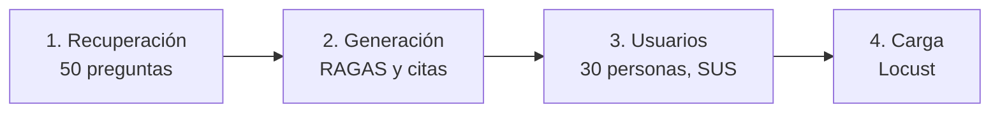

# Protocolo de evaluación

La evaluación tiene cuatro partes. Las dos primeras son automáticas y se repiten con cada cambio del asistente; las otras dos se hacen una vez, al final.



## 1. Recuperación

Las 50 preguntas de [`preguntas_referencia.json`](../../rag/evaluacion/preguntas_referencia.json) cubren los casos de uso:

| Tipo | Preguntas | Caso de uso | Resultado esperado |
| --- | --- | --- | --- |
| `nombre` | 9 | CU-01 | La empresa nombrada en el top 5 |
| `cifra` | 4 | CU-04 | La empresa en el top 5 y su cifra desde B |
| `actividad` | 19 | CU-02 | Al menos una empresa con el CIIU esperado en el top 5 |
| `actividad_lugar` | 6 | CU-03 | Al menos una empresa con el CIIU y la ciudad esperados |
| `sin_dato` | 4 | CU-05 | "No hay dato publicado" |
| `fuera_de_alcance` | 8 | CU-07 | "No hay dato publicado" |

| Métrica | Definición | Meta |
| --- | --- | --- |
| Acierto@5 | Preguntas con respuesta que tienen un resultado esperado en el top 5 | ≥ 0,90 |
| MRR | Promedio de 1 / posición del primer resultado esperado | ≥ 0,80 |
| Rechazo correcto | Preguntas `fuera_de_alcance` rechazadas | 1,00 |
| Sin dato correcto | Preguntas `sin_dato` rechazadas | 1,00 |
| Falsos rechazos | Preguntas con respuesta que el asistente rechazó | 0 |

```powershell
$env:PYTHONPATH = "rag/src"
python -m rag evaluar --salida rag/evidencias/eval50.json
```

## 2. Generación

Se mide sobre las 38 preguntas con respuesta, con el LLM activo.

| Métrica | Qué mide | Meta |
| --- | --- | --- |
| Citas válidas | Respuestas del LLM que citan solo fuentes recuperadas | ≥ 0,95 |
| RAGAS `faithfulness` | Afirmaciones respaldadas por el contexto | ≥ 0,85 |
| RAGAS `answer_relevancy` | Pertinencia de la respuesta a la pregunta | ≥ 0,80 |
| RAGAS `context_precision` | Fragmentos recuperados que son útiles | ≥ 0,70 |
| Revisión manual | Español correcto y citas bien puestas en 20 respuestas, escala 1–5 | ≥ 4 |

La comparación de modelos usa estas mismas métricas ([evaluación](evaluacion.md#comparación-de-llm)).

## 3. Usuarios

| Elemento | Detalle |
| --- | --- |
| Participantes | Al menos 30: estudiantes, docentes e investigadores de la EPN |
| Sesión | 20 minutos, en línea o presencial, con consentimiento informado |
| Datos | Anónimos: código de participante, sin nombre ni correo |
| Tareas | Cinco, una por caso de uso CU-01 a CU-05 |
| Medidas | Tarea resuelta (sí/no), tiempo por tarea, cuestionario SUS y un comentario libre |

| Tarea | Consigna |
| --- | --- |
| T1 | Averigua a qué se dedica una empresa que conozcas |
| T2 | Encuentra tres empresas que ofrezcan servicios de software |
| T3 | Encuentra empresas de tecnología en una ciudad distinta de Quito y Guayaquil |
| T4 | Averigua cuánto vendió una empresa grande en 2025 |
| T5 | Averigua cómo contactar a una empresa del piloto |

### Cuestionario SUS

Escala de 1 (totalmente en desacuerdo) a 5 (totalmente de acuerdo).

1. Creo que me gustaría usar este asistente con frecuencia.
2. Encontré el asistente innecesariamente complejo.
3. Pensé que el asistente era fácil de usar.
4. Creo que necesitaría ayuda de una persona con conocimientos técnicos para usar este asistente.
5. Encontré que las funciones del asistente estaban bien integradas.
6. Pensé que había demasiada inconsistencia en el asistente.
7. Imagino que la mayoría de las personas aprendería a usar este asistente muy rápido.
8. Encontré el asistente muy difícil de usar.
9. Me sentí muy seguro al usar el asistente.
10. Necesité aprender muchas cosas antes de poder usar el asistente.

Puntaje: en las preguntas impares se resta 1 a la respuesta; en las pares, la respuesta se resta de 5. La suma se multiplica por 2,5 y da un valor de 0 a 100. La meta es ≥ 68, el promedio de referencia de la escala.

## 4. Carga

| Elemento | Detalle |
| --- | --- |
| Herramienta | Locust contra `POST /chat` en el servidor de despliegue |
| Escenario | 10, 25 y 50 usuarios simultáneos durante 5 minutos, con las 50 preguntas |
| Medidas | Latencia p50 y p95, errores y uso de CPU |
| Meta | p95 ≤ 8 s con 25 usuarios y menos de 1 % de errores |
