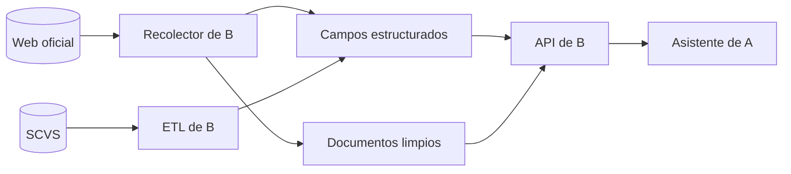

# Ficha de empresa

La ficha sigue el esquema Company Profile, pensado para un directorio digital. B recolecta las webs una sola vez y produce los campos estructurados. A indexa los documentos que B expone y responde con cita ([ADR 0006](adr/0006-bloque2-company-profile-en-b.md)).

## Campos

| Bloque | Campo | Fuente | Produce |
| --- | --- | --- | --- |
| 1. Identificación | Nombre comercial y razón social | Web, SCVS | B |
| 1. Identificación | Contacto corporativo: web, correo, teléfono, redes | Web | B |
| 1. Identificación | Ubicación | Web, SCVS | B |
| 1. Identificación | Sector CIIU y tamaño | SCVS | B |
| 2. Contenido | Descripción corta (máx. 150 caracteres) | Web | B |
| 2. Contenido | Descripción detallada (2–3 párrafos) | Web, informe anual | B |
| 2. Contenido | Productos y servicios por categoría | Web, catálogos | B |
| 2. Contenido | Misión, visión, historia | Documentos expuestos por B | A |
| 3. Validación | Logotipo | Web | B |
| 3. Validación | Palabras clave | Texto y CIIU | A |
| 3. Validación | Certificaciones y premios | Documentos expuestos por B | A |
| Cifras | Ventas, utilidad, empleados, años en el mercado | SCVS | B |

No se guardan fotos, reseñas, horarios, métodos de pago, cargos directivos ni datos personales.

## Metadatos de cada campo

| Campo | Uso |
| --- | --- |
| `fuente_url` | Cita |
| `fuente_tipo` | `web_oficial`, `informe_anual_oficial`, `catalogo_oficial`, `prensa`, entre otros |
| `fecha_captura` | Vigencia |
| `sha256` | Detectar cambios entre capturas |
| `origen` | `literal` (copiado) o `derivado` (redactado a partir de la fuente) |

## Reglas

| Regla | Motivo |
| --- | --- |
| Las cifras se piden a la API de B, nunca al texto | Una sola fuente de verdad |
| Campo sin fuente: "no hay dato publicado" | Evitar respuestas inventadas |
| Toda respuesta cita URL y fecha | Trazabilidad |
| Solo canales corporativos de contacto | Ley Orgánica de Protección de Datos Personales |
