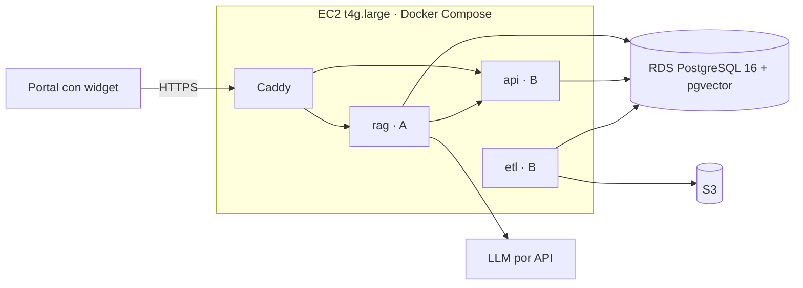

# Infraestructura

Se desarrolla en local con Docker Compose y se despliega la misma composición en la cuenta AWS de la EPN. No se necesita GPU: el LLM es un servicio por API y los embeddings corren en CPU ([ADR 0008](adr/0008-infraestructura.md)).



## Recursos solicitados

| Recurso | Configuración | USD / mes |
| --- | --- | --- |
| EC2 | `t4g.large`, 30 GB | ~52 |
| RDS PostgreSQL 16 con pgvector | `db.t4g.small`, 20 GB | ~26 |
| IPv4 pública | 1 | ~4 |
| S3, CloudWatch, Parameter Store | < 10 GB | ~3 |
| LLM | Según el modelo elegido | 3–50 |
| **Total** | | **~88–135** |

El tope es de USD 150 al mes, con alertas de AWS Budgets al 50, 80 y 100 %. La región es `us-east-1`. Todos los recursos son compartidos entre A y B, con esquemas y prefijos separados.

## Base de datos

| Esquema | Rol | Dueño |
| --- | --- | --- |
| Esquemas de B | `rol_datos` | B |
| `asistente` | `rol_asistente` | A |

Ningún rol tiene permisos sobre los esquemas del otro ([ADR 0002](adr/0002-postgresql-esquemas-roles.md)).

## Entorno local

```powershell
$env:PG_PASS = Read-Host -Prompt "Clave Postgres"
docker run -d --name obs-pg -e POSTGRES_PASSWORD=$env:PG_PASS -p 5432:5432 pgvector/pgvector:pg16
docker exec -it obs-pg psql -U postgres -c "CREATE EXTENSION IF NOT EXISTS vector;"
```

En desarrollo, el LLM se usa con claves personales de bajo tope o con un modelo local de Ollama, detrás de la misma interfaz compatible con OpenAI.
