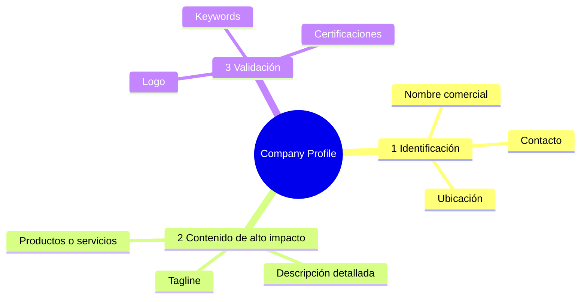

# 2. Company Profile: Bloque 2 (contenido de alto impacto)

Del formato *Company Profile* se acordó cubrir el Bloque 2, que es lo que lee el usuario. Los bloques 1 y 3 quedan fuera de este alcance.



## Campos y reglas

| Campo | Definición del formato | Regla del proyecto | Validación |
| --- | --- | --- | --- |
| `tagline` | Frase de máximo 150 caracteres sobre qué hace la empresa | Tomar la frase de la propia empresa (misión, lema, `og:description`); si no existe, derivarla | ≤ 150 caracteres; no vacío si `estado = completo` |
| `descripcion` | 2–3 párrafos cortos: propuesta de valor, experiencia, soluciones | Resumen propio basado en la fuente; sin opiniones ni cifras no publicadas | 200–1.200 caracteres |
| `productos_servicios` | Lista organizada por categorías | Lista separada por `;`, agrupada por línea de negocio cuando la fuente lo hace | Al menos 1 elemento |

## Metadatos obligatorios por fila

| Campo | Para qué |
| --- | --- |
| `fuente_url` | Citación explícita (F_AA_233A) |
| `fuente_tipo` | `web_oficial`, `informe_anual_oficial`, `memoria_sostenibilidad_oficial`, `catalogo_oficial`, `tercero_institucional`, `prensa` |
| `fecha_captura` | Trazabilidad y vigencia |
| `sha256` | Detectar cambios entre capturas |
| `tagline_origen` | `literal` (copiado de la fuente) o `derivado` (redactado a partir de ella) |
| `estado` | `completo`, `parcial`, `pendiente` |

## Por qué `literal` y `derivado`

El formulario F_AA_233A exige salvaguardas contra respuestas no fundamentadas. Distinguir lo copiado de lo redactado permite que el asistente de A cite con precisión y que el portal muestre la procedencia. Si se usa un LLM para redactar, la fila queda `derivado` y conserva la URL de la fuente.

## Esquema en Oro

```sql
CREATE TABLE oro.ficha_contenido (
  expediente          integer     NOT NULL,
  tagline             varchar(150),
  tagline_origen      text        CHECK (tagline_origen IN ('literal','derivado')),
  descripcion         text,
  productos_servicios text[],
  fuente_tipo         text        NOT NULL,
  fuente_url          text        NOT NULL,
  fecha_captura       date        NOT NULL,
  sha256              char(64),
  estado              text        CHECK (estado IN ('completo','parcial','pendiente')),
  PRIMARY KEY (expediente, fecha_captura)
);
```
