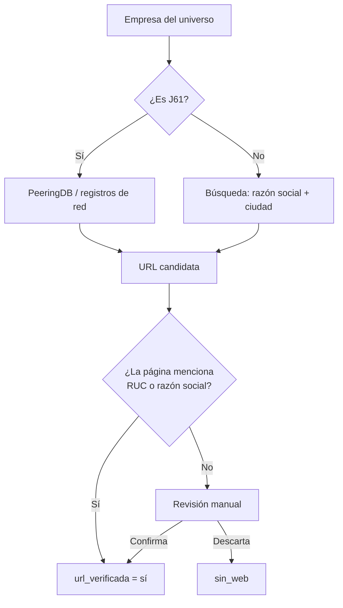

# 4. Descubrimiento de la web oficial

La SCVS no vincula el expediente con un sitio web. Encontrar la URL oficial es el cuello de botella del Bloque 2, más que extraer el texto.

## Estrategias

| Estrategia | Para quién | Costo | Evidencia |
| --- | --- | --- | --- |
| PeeringDB | Telecomunicaciones (J61) | Bajo | Encontró la URL de CONECEL en el piloto |
| Dominio de PDF oficiales ya encontrados | Grandes con memoria anual | Bajo | Favorita, PRONACA, SaludSA |
| Búsqueda semimanual (razón social + ciudad) y validación | Resto | Medio-alto | Fallo en 3 de 10 del piloto |
| Directorios de gremios (CITEC, cámaras) | Tecnológicas | Por verificar | No se halló un directorio público de socios |
| Correo a la empresa o al gremio | Casos sin web | Alto | Último recurso |

## Regla de verificación

Una URL se acepta solo si la página (portada, pie o "nosotros") muestra el RUC, la razón social o el nombre comercial con similitud ≥ 0,85 (`rapidfuzz`). Si no, pasa a revisión manual. Se guarda quién verificó y cuándo.

## Columnas en `universo_bloque2.csv`

| Columna | Valores |
| --- | --- |
| `url_oficial` | URL raíz |
| `url_fuente` | `peeringdb`, `pdf_oficial`, `busqueda`, `gremio`, `manual` |
| `url_verificada` | `si`, `no`, `sin_web` |

## Estimación de esfuerzo (a validar)

| Supuesto | Valor |
| --- | --- |
| Minutos por empresa en búsqueda semimanual | 2–3 |
| Piloto de 500 empresas | 17–25 horas |
| Universo completo (14.042) | Inviable a mano; requiere convenio o acotar |
