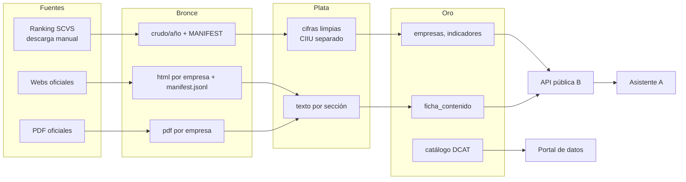

# 5. Arquitectura y pipeline del ETL

Se propone Medallion (bronce, plata, oro) como esquemas del PostgreSQL del componente, un pipeline en Python ejecutado por comandos y CI en GitHub Actions. No se usa Airflow.

## Cómo encajan las metodologías

| Nivel | Qué define | En B |
| --- | --- | --- |
| Scrum | Organización del trabajo | Sprints del plan F_AA_234A |
| CRISP-DM | Fases del tratamiento del dato | Comprensión → preparación → modelado → evaluación → despliegue |
| Medallion | Estado del dato almacenado | Bronce = crudo, Plata = limpio, Oro = publicado |
| Pipeline por comandos | Automatización | `python -m etl <paso>` |
| CI/CD | Calidad del código | `ruff` + `pytest` en cada push |

Relación CRISP-DM ↔ Medallion: comprensión de datos ↔ Bronce; preparación ↔ Plata; modelado de indicadores ↔ Oro; despliegue ↔ API y portal. Es el mismo esquema que usó Defaz (EPN, 2026), pero con la orquestación más liviana.

## Flujo

## Comandos del pipeline

| Comando | Capa | Hace |
| --- | --- | --- |
| `etl carga` | Bronce → Plata | Lee el ranking, separa CIIU, normaliza nombres |
| `etl calidad` | Plata | Reglas de calidad y reporte |
| `etl universo` | Plata | Filtra sectores y tamaños; genera `universo_bloque2.csv` |
| `etl web` | Bronce | Corre el spider sobre las URL verificadas |
| `etl texto` | Plata | Extrae texto de HTML y PDF |
| `etl ficha` | Oro | Llena `ficha_contenido` |
| `etl indicadores` | Oro | Agregados por CIIU, tamaño y año |
| `etl catalogo` | Oro | Metadatos DCAT |

Cada paso es idempotente: si se repite, no duplica filas.

## Herramientas

| Necesidad | Herramienta | Por qué |
| --- | --- | --- |
| Recolección web | Scrapling | robots.txt nativo, límite por dominio, licencia BSD ([06](06-scraping-etico.md)) |
| Texto principal de HTML | trafilatura | Quita menús y pie; deja el cuerpo |
| Metadatos y JSON-LD | extruct | Lee `og:`, `meta` y `Organization` |
| Texto de PDF | pdfplumber o pypdf | Memorias e informes |
| Coincidencia de nombres | rapidfuzz | Verifica la URL ([04](04-descubrimiento-de-urls.md)) |
| Calidad de datos | pandera | Esquemas y reglas sobre DataFrames, más liviano que Great Expectations |
| Tablas | pandas + SQLAlchemy Core + Alembic | Ya en el stack del repo |
| Proyecciones | statsmodels | Ya previsto en el repo |
| DCAT | rdflib o CKAN | Depende del ADR del portal |
| CLI | typer o argparse | Comandos `etl <paso>` |

## Por qué no Airflow

| Criterio | Defaz (Airflow) | B |
| --- | --- | --- |
| Fuentes | 5 instituciones, 30+ DAGs | SCVS + webs de empresas |
| Frecuencia | Varias actualizaciones | Anual (ranking) y por campaña (webs) |
| Costo operativo | Servidor, base de metadatos, workers | Ninguno adicional |

Si más adelante hiciera falta orquestar, Prefect o Dagster se integran sobre los mismos comandos sin reescribirlos.

## CI en GitHub Actions

| Disparador | Trabajo |
| --- | --- |
| `push` y `pull_request` en `etl/**` | `ruff check` + `pytest --cov` |
| Manual (`workflow_dispatch`) | `etl calidad` sobre una muestra |
| Opcional: `schedule` anual | `etl carga` cuando sale el ranking nuevo |

Las pruebas usan HTML y PDF de ejemplo locales; el spider ya se probó así ([06](06-scraping-etico.md)).
