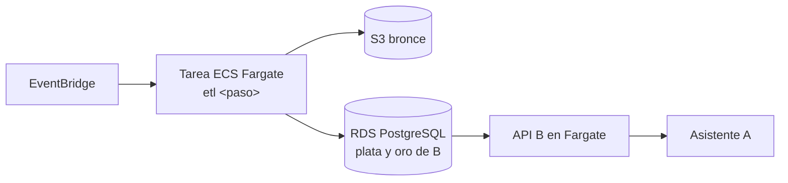

# 7. Alternativa en AWS

La opción por defecto es local y en la infraestructura de la EPN. AWS queda como alternativa, alineada con lo que el Componente A propone solicitar ([`../investigacion/07`](../investigacion/07-infraestructura-aws.md)): un PostgreSQL compartido, contenedores y un bucket S3.

## Equivalencias

| Pieza | Opción por defecto | Alternativa AWS |
| --- | --- | --- |
| Bronce (archivos crudos, HTML, PDF) | Carpeta versionada + `MANIFEST.csv` | S3 con prefijos `bronce/`, versionado activado |
| Plata y Oro (tablas) | PostgreSQL local o EPN, esquema de B | RDS PostgreSQL compartido con A, esquema y rol de B |
| Ejecución del pipeline | Comandos `etl <paso>` en la máquina o en CI | Mismo contenedor en ECS Fargate (tarea) o Lambda para pasos cortos |
| Programación | GitHub Actions `schedule` | EventBridge Scheduler |
| Orquestación (si crece) | Prefect o Dagster | Step Functions; MWAA (Airflow gestionado) solo si de verdad se necesita |
| Texto de PDF escaneados | pdfplumber (si hay texto) | Textract para los PDF sin capa de texto |
| Redacción de taglines `derivado` | Manual o LLM por API | Bedrock, con la misma interfaz que use A |
| API pública | Contenedor propio | ECS Fargate detrás del subdominio compartido |

## Cuándo conviene

| Situación | Recomendación |
| --- | --- |
| Piloto de ~500 empresas | Local o EPN |
| La EPN asigna la cuenta AWS al proyecto | Mover Bronce a S3 y la base a RDS compartido |
| Campañas de recolección largas | Fargate por tarea, sin servidor encendido |
| PDF escaneados en volumen | Textract |

## Riesgos

| Riesgo | Mitigación |
| --- | --- |
| Costo sin control | Presupuesto y alertas en AWS Budgets; estimar con AWS Pricing Calculator antes de solicitar |
| Dependencia del proveedor | El código es el mismo contenedor que corre local; solo cambian rutas y conexión |
| Credenciales en el repositorio | Secrets Manager o variables de entorno; nunca en el código |
