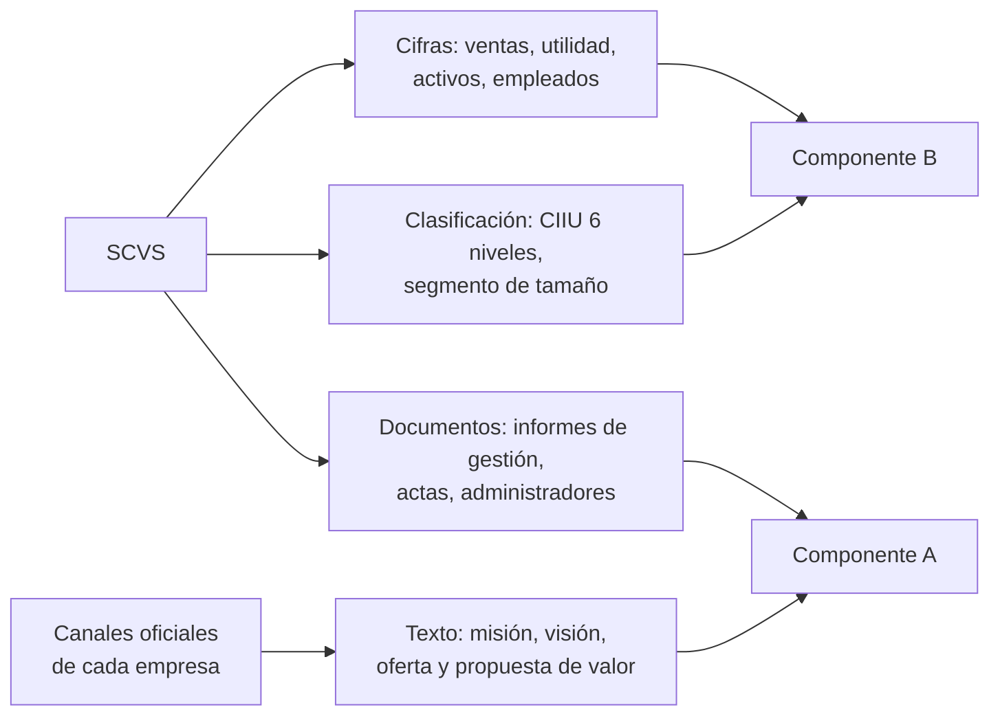

# 1. La Superintendencia de Compañías como fuente

La Superintendencia de Compañías, Valores y Seguros (SCVS) aporta cifras y clasificación de las sociedades; no aporta misión, visión ni oferta de valor.

## Recursos oficiales disponibles

| Recurso | Contenido | Uso propuesto | Fuente |
| --- | --- | --- | --- |
| Ranking Compañías (descarga) | Expediente, posición, ingresos por ventas, utilidad neta, segmento, CIIU niveles 1 a 6; indicadores por actividad económica | Cifras y clasificación sector/tamaño (ETL de B) | [SCVS – Ranking](https://appscvsmovil.supercias.gob.ec/ranking/reporte.html) |
| Directorio de compañías | Datos de las compañías registradas, formato ODS, con diccionario de datos | Universo de empresas y metadatos | [Datos Abiertos Ecuador](https://datosabiertos.gob.ec/dataset/directorio-de-companias) |
| Portal de Información → Búsqueda de compañías | Por empresa: información general, estado de situación, resultados, flujo de efectivo | Consulta puntual, no masiva | [SCVS – Manual de consulta](https://appscvsmovil.supercias.gob.ec/guiasUsuarios/images/guias/con_est_fin/MANUAL_CONSULTAR_INFORMACION_FINANCIERA.pdf) |
| Portal de Documentos | Documentos generales, jurídicos y económicos | Texto oficial para la ficha (informes de gestión) | [Derecho Ecuador](https://derechoecuador.com/certificados-por-la-superintendencia-de-companias/) |

## Indicadores de dimensión

| Indicador | Valor | Fuente |
| --- | --- | --- |
| Compañías activas (2025) | 172.641 | [El Comercio](https://www.elcomercio.com/lideres/ranking-empresarial-ventas-millones-dolares/) |
| Ingresos por ventas reportados (2025) | USD 165.890 millones | [El Comercio](https://www.elcomercio.com/lideres/ranking-empresarial-ventas-millones-dolares/) |
| Empresas que entregaron estados financieros 2025 (al 5-may-2026) | 148.404 | [Expreso](https://www.expreso.ec/economia-y-negocios/estados-financieros-2025-asi-ranking-empresas-facturan-ecuador-281110.html) |
| Composición por tamaño (2025) | Micro 69,21 % · Pequeña 21,64 % · Mediana 6,4 % · Grande 2,72 % | [El Comercio](https://www.elcomercio.com/lideres/ranking-empresarial-ventas-millones-dolares/) |
| Ranking más antiguo publicado | 2008 | [Bloomberg Línea](https://www.bloomberglinea.com/latinoamerica/ecuador/estas-son-las-10-empresas-que-mas-vendieron-en-ecuador-en-2023/) |

## Límites de la fuente

| Límite | Consecuencia | Fuente |
| --- | --- | --- |
| Solo sociedades (S.A., Cía. Ltda., S.A.S., extranjeras); excluye personas naturales | El universo no equivale a todo el tejido empresarial | [Primicias](https://primicias.ec/economia/empresas-estados-financieros-superintendencia-companias-93001) |
| No todas las compañías activas reportan cada año | Series con huecos; marcar empresas sin reporte | [Primicias](https://www.primicias.ec/noticias/economia/empresas-ingresos-ventas-ranking-ecuador-superintendencia-companias) |
| El ranking inicial es preliminar y se actualiza | Fijar fecha de corte en cada descarga | [El Diario](https://www.eldiario.ec/zona-2/superintendencia-de-companias-revela-el-top-10-de-empresas-con-mayores-ingresos-en-ecuador-en-2024-16052025/) |

## Antecedente reutilizable

| Trabajo | Aporte | Origen |
| --- | --- | --- |
| Tesis de posgrado de Paul Reynoso (analítica empresarial con SCVS y Banco Central) | Archivos CSV/Excel y rutas de obtención ya probadas | Mención del director en reunión |
