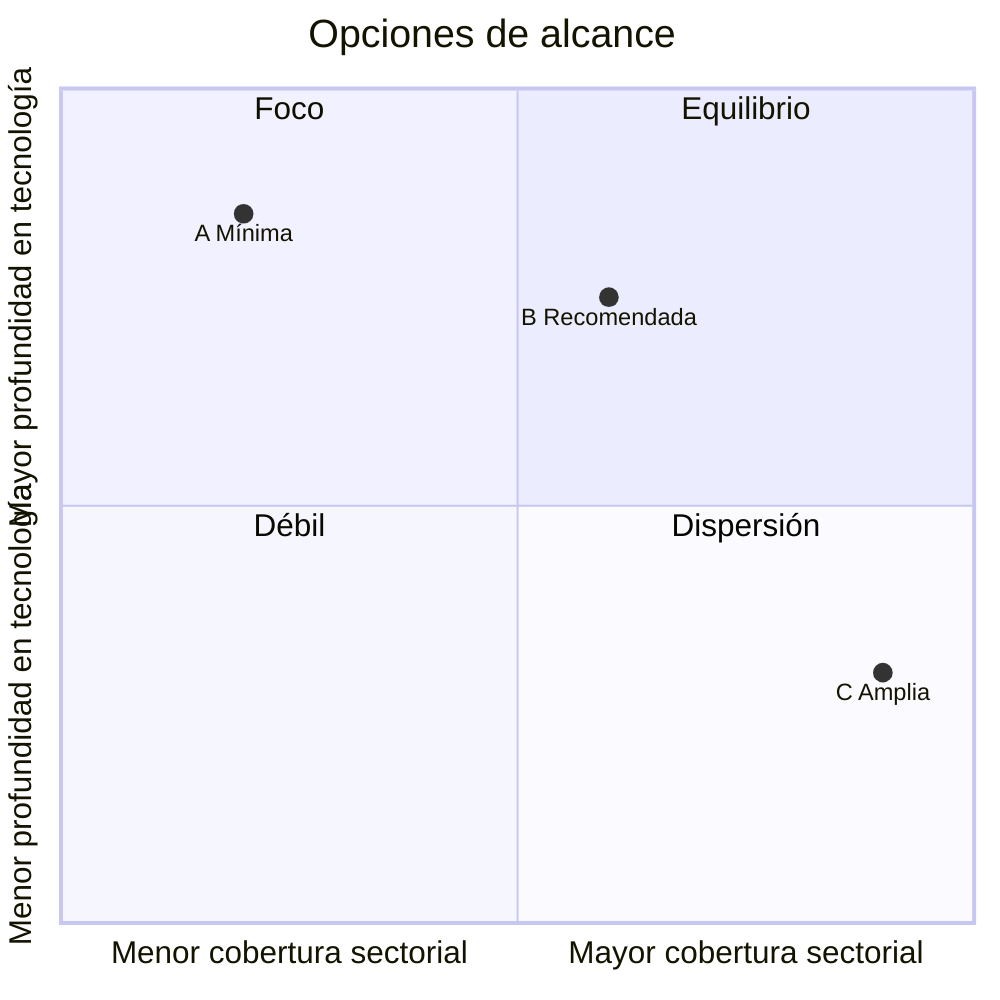

# 2. Sectores y tamaños

Se propone segmentar por sector (CIIU) y usar el tamaño como filtro. El ranking de la SCVS ya trae ambos campos; el costo real está en el corpus textual.

## Núcleo tecnológico (CIIU Rev. 4)

| Código | Actividad | Fuente |
| --- | --- | --- |
| J61 | Telecomunicaciones | [ONU – CIIU Rev. 4/5, división J](https://unstats.un.org/unsd/classifications/Workshops/Santiago2025/Session2.2_ISIC_DivJ&K_NZ.pdf) |
| J62 | Programación, consultoría informática y actividades conexas | [ONU – CIIU Rev. 4/5](https://unstats.un.org/unsd/classifications/Workshops/Santiago2025/Session2.2_ISIC_DivJ&K_NZ.pdf) |
| J63 | Actividades de servicios de información | [ONU – CIIU Rev. 4/5](https://unstats.un.org/unsd/classifications/Workshops/Santiago2025/Session2.2_ISIC_DivJ&K_NZ.pdf) |
| J582 | Edición de programas informáticos | [ONU – CIIU Rev. 4/5](https://unstats.un.org/unsd/classifications/Workshops/Santiago2025/Session2.2_ISIC_DivJ&K_NZ.pdf) |

Referencia de tamaño del ecosistema: el Radar Industria Tech EC de CITEC registra 520 compañías tecnológicas, 313 en Quito ([KCH Comunicación](https://kchcomunicacion.com/?p=383605)). El conteo exacto por CIIU sale de la primera descarga del ranking.

## Opciones de alcance

| Opción | Cifras SCVS | Ficha textual | Carga | Observación |
| --- | --- | --- | --- | --- |
| A. Mínima | Tecnológicas, todos los tamaños | Tecnológicas con web oficial | Baja | Sin comparación entre sectores |
| **B. Recomendada** | Tecnológicas + G Comercio + C Manufactura (incluye agroindustria) + K/M Servicios | Tecnológicas con web + medianas y grandes de G, C, K/M | Media | Coincide con los grupos citados por el director |
| C. Amplia | Todos los sectores | Solo grandes | Alta | Poca profundidad en tecnología |

## Clasificación por tamaño (COPCI)

Criterios: personal ocupado y ventas anuales; si no coinciden, prima ventas ([ESPE](https://yura.espe.edu.ec/wp-content/uploads/2017/12/13.6-Análisis-descriptivo-de-las-características-empresariales-y-financieras-de-las-pymes-en-Ecuador.pdf)).

| Tamaño | Personal | Ventas anuales (versión A) | Ventas anuales (versión B) |
| --- | --- | --- | --- |
| Micro | 1–9 | Hasta USD 100.000 | Hasta USD 300.000 |
| Pequeña | 10–49 | USD 100.001–1.000.000 | USD 300.001–1.000.000 |
| Mediana | 50–199 | USD 1.000.001–5.000.000 | USD 1.000.001–5.000.000 |
| Grande | 200 o más | Más de USD 5.000.000 | Más de USD 5.000.000 |
| Fuente | [Dialnet](https://dialnet.unirioja.es/descarga/articulo/7210406.pdf) | Reglamento COPCI citado en literatura | [EY Ecuador, 2024](https://ey.com/content/dam/ey-unified-site/ey-com/es-ec/technical/tax/documents/ey-tax-alert-7_6feb24-informativo-mipymes-condonacion.pdf) |

Pendiente: confirmar el umbral vigente de microempresa. Se recomienda usar el campo de segmento de la SCVS y no recalcular el tamaño.

## Riesgo de clasificación

| Riesgo | Detalle | Mitigación | Fuente |
| --- | --- | --- | --- |
| CIIU Rev. 5 | La sección J se divide; telecomunicaciones, programación e infraestructura de cómputo pasan a una nueva sección K | Guardar código de 6 niveles + tabla de correspondencia Rev. 4 ↔ Rev. 5 | [ONU – UNSD](https://unstats.un.org/unsd/classifications/Meetings/UNCEISC2023/Session03_Pres1_UNSD_Update_on_ISIC_Rev5.pdf) |
