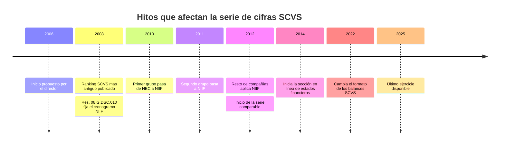

# 3. Periodo de análisis

Partir de 2006 es viable para la historia de cada empresa, pero las cifras de 2006–2011 no son comparables con las posteriores. Se propone una serie principal 2012–2025.

| Año | Hecho | Efecto en el proyecto | Fuente |
| --- | --- | --- | --- |
| 2008 | Ranking SCVS más antiguo publicado | Antes de 2008 no hay ranking; solo datos por empresa o por solicitud | [Bloomberg Línea](https://www.bloomberglinea.com/latinoamerica/ecuador/estas-son-las-10-empresas-que-mas-vendieron-en-ecuador-en-2023/) |
| 2008 | Res. 08.G.DSC.010 establece la adopción escalonada de NIIF 2010–2012 | Años mixtos NEC/NIIF | [UASB](https://repositorio.uasb.edu.ec/bitstream/10644/3431/1/T1256-MBA-Gallegos-Analisis.pdf) |
| 2012 | Último grupo adopta NIIF | Inicio de la serie comparable | [UASB](https://repositorio.uasb.edu.ec/bitstream/10644/3431/1/T1256-MBA-Gallegos-Analisis.pdf) |
| 2014 | La sección de entrega en línea cubre 2014 en adelante; años previos a 2013 se gestionan por trámite | Datos antiguos pueden requerir solicitud formal | [El Diario](https://www.eldiario.ec/negocios/empresas-deben-presentar-estados-financieros-hasta-el-30-de-abril-01042025/) |
| 2022 | El INEC reporta cambio de formato en los balances de la SCVS | Revisar el mapeo de cuentas en el ETL | [INEC](https://www.ecuadorencifras.gob.ec/documentos/web-inec/Estadisticas_Economicas/Registro_Empresas_Establecimientos/2025/Semestre_I/Evolucion_historica_REEM.pdf) |

## Propuesta

| Tramo | Uso | Advertencia en el asistente |
| --- | --- | --- |
| 2012–2025 | Serie principal de cifras y proyecciones | Ninguna |
| 2006–2011 | Serie histórica, solo si se obtiene | "Datos previos a NIIF; no comparables" |
| Desde la fundación | Historia e hitos en la ficha textual | No aplica |

| Criterio bibliográfico | Regla | Origen |
| --- | --- | --- |
| Literatura técnica | Últimos 5 años | Reunión con el director |
| Obras seminales | Se incluyen sin límite de antigüedad | Reunión con el director |
