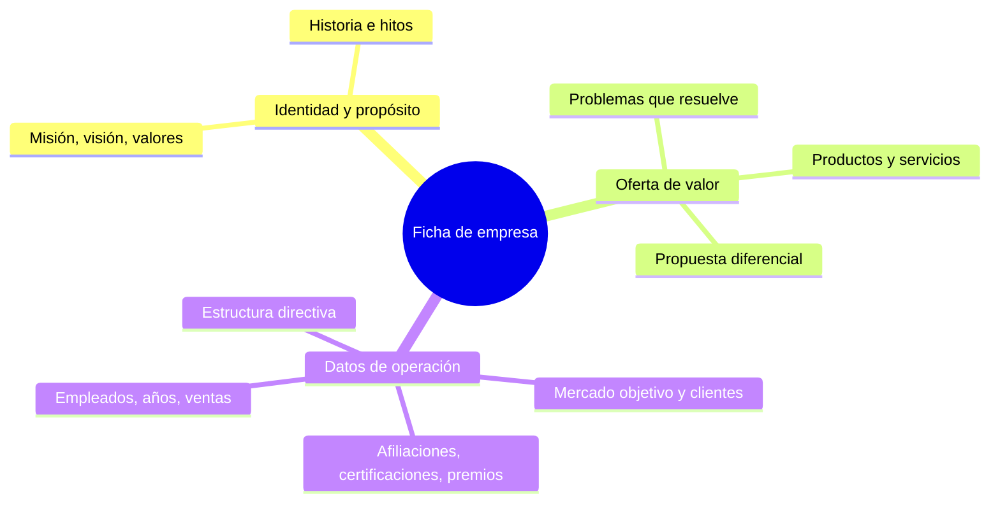

# 4. Ficha de empresa desde canales oficiales

Cada empresa del corpus tiene una ficha con los tres bloques que definió el director. Cada campo guarda URL y fecha de captura para que el asistente lo cite.

| Bloque | Campo | Fuente oficial | Componente |
| --- | --- | --- | --- |
| Identidad | Misión, visión, valores | Sitio web oficial, memoria anual, informe de sostenibilidad | A |
| Identidad | Historia e hitos | Sitio web; fecha de constitución desde la SCVS | A + B |
| Oferta | Productos y servicios, problemas que resuelve | Sitio web, catálogos, prospectos de emisión si cotiza | A |
| Oferta | Propuesta de valor diferencial | Sitio web, informe de gestión (Portal de Documentos SCVS) | A |
| Operación | Mercado objetivo y clientes | Sitio web, casos de éxito publicados | A |
| Operación | Afiliaciones, certificaciones, premios | Sitio web, gremios del sector | A |
| Operación | Estructura directiva | Sitio web; solo cargos, sin datos personales adicionales | A |
| Operación | Empleados, años en el mercado, ventas, utilidad | SCVS, servido por la API de B | B |

Origen de la estructura: reunión con el director (identidad y propósito, oferta de valor, datos de operación).

## Reglas del asistente sobre la ficha

| Regla | Motivo |
| --- | --- |
| Toda cifra se toma de la API de B, nunca del texto indexado | Evita contradicciones entre fuentes |
| Campo sin fuente oficial → responde "no hay dato publicado" | Salvaguarda contra alucinaciones (F_AA_233A) |
| Cada respuesta cita URL y fecha de captura | Requisito de citación explícita (F_AA_233A) |
| Solo cargos directivos, no datos personales | Ley Orgánica de Protección de Datos Personales |
