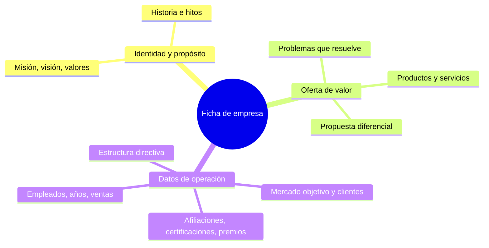

# 4. Ficha de empresa desde canales oficiales

Cada empresa del corpus tiene una ficha con los tres bloques que definió el director. Cada campo guarda URL y fecha de captura para que el asistente lo cite.

| Bloque | Campo | Fuente oficial | Componente |
| --- | --- | --- | --- |
| Identidad | Misión, visión, valores | Sitio web oficial, memoria anual, informe de sostenibilidad | A |
| Identidad | Historia e hitos | Sitio web; fecha de constitución desde la SCVS | A + B |
| Oferta | Productos y servicios, problemas que resuelve | Sitio web, catálogos, prospectos de emisión si cotiza | A |
| Oferta | Propuesta de valor diferencial | Sitio web, informe de gestión (Portal de Documentos SCVS) | A |
| Operación | Mercado objetivo y clientes | Sitio web, casos de éxito publicados | A |
| Operación | Afiliaciones, certificaciones, premios | Sitio web, gremios del sector | A |
| Operación | Estructura directiva | Excluida en v2 ([10](10-coherencia-con-componente-b.md), I5) | — |
| Operación | Empleados, años en el mercado, ventas, utilidad | SCVS, servido por la API de B | B |

Origen de la estructura: reunión con el director (identidad y propósito, oferta de valor, datos de operación).

## Versión 2: esquema Company Profile (propuesta)

En [RN-01](../reuniones/RN-01-ficha-alcance-antecedentes.md) se eligió el esquema Company Profile (`Company Profile DTIC.docx`), pensado para un directorio en una plataforma digital. Se propone usarlo como estructura de la ficha y conservar del esquema anterior lo que el asistente necesita para responder. Falta la confirmación del director.

La columna "Componente" de la tabla siguiente refleja la enmienda propuesta al [ADR 0006](../adr/0006-bloque2-company-profile-en-b.md): B recolecta una sola vez y produce los campos estructurados; A indexa los documentos que B expone y produce las palabras clave y las respuestas con cita ([10](10-coherencia-con-componente-b.md), I1).

| Bloque Company Profile | Campo | Fuente oficial | Componente | Origen |
| --- | --- | --- | --- | --- |
| 1. Identificación | Nombre comercial (y razón social) | Sitio web; razón social desde la SCVS | B | Company Profile |
| 1. Identificación | Contacto: web, correo corporativo, teléfono, redes activas | Sitio web oficial, JSON-LD `Organization` | B | Company Profile |
| 1. Identificación | Ubicación y cobertura geográfica | Sitio web; provincia y ciudad desde la SCVS | B | Company Profile |
| 1. Identificación | Sector CIIU y tamaño | SCVS | B | Necesario para filtrar |
| 2. Contenido de alto impacto | Descripción corta (máx. 150 caracteres) | Literal o derivada del sitio, con cita | B | Company Profile |
| 2. Contenido de alto impacto | Descripción detallada (2–3 párrafos): propuesta de valor, experiencia, soluciones | Sitio web, informe anual o de gestión | B | Company Profile |
| 2. Contenido de alto impacto | Productos y servicios por categoría | Sitio web, catálogos | B | Company Profile |
| 2. Contenido de alto impacto | Misión, visión, historia e hitos | Documentos capturados por B y expuestos por API | A | Esquema v1 (pedido explícito del director) |
| 3. Activos visuales y validación | Logotipo (PNG transparente o SVG) | Sitio web, JSON-LD `logo` u `og:image` | B | Company Profile |
| 3. Activos visuales y validación | Palabras clave | Derivadas del texto y del CIIU | A | Company Profile |
| 3. Activos visuales y validación | Certificaciones, premios, afiliaciones | Documentos capturados por B y expuestos por API | A | Company Profile + v1 |
| Cifras (fuera de la ficha textual) | Empleados, años en el mercado, ventas, utilidad | SCVS por la API de B | B | Esquema v1 |

| Cambio respecto a v1 | Motivo |
| --- | --- |
| Entran contacto, ubicación, descripción corta, logotipo y palabras clave | El producto es un directorio: el usuario busca "quién hace X" y necesita contactarlo |
| La descripción corta y las palabras clave se indexan aparte | Mejoran la recuperación por necesidad del usuario, no solo por nombre de empresa |
| Se descartan horarios, métodos de pago, fotos y reseñas (esquema 3) | Más costosos de mantener y con poco valor para el Observatorio (D2 de RN-01) |
| Contacto: solo canales corporativos | Ley Orgánica de Protección de Datos Personales; no se guardan correos ni teléfonos personales |

## Reglas del asistente sobre la ficha

| Regla | Motivo |
| --- | --- |
| Toda cifra se toma de la API de B, nunca del texto indexado | Evita contradicciones entre fuentes |
| Campo sin fuente oficial → responde "no hay dato publicado" | Salvaguarda contra alucinaciones (F_AA_233A) |
| Cada respuesta cita URL y fecha de captura | Requisito de citación explícita (F_AA_233A) |
| Solo cargos directivos, no datos personales | Ley Orgánica de Protección de Datos Personales |
