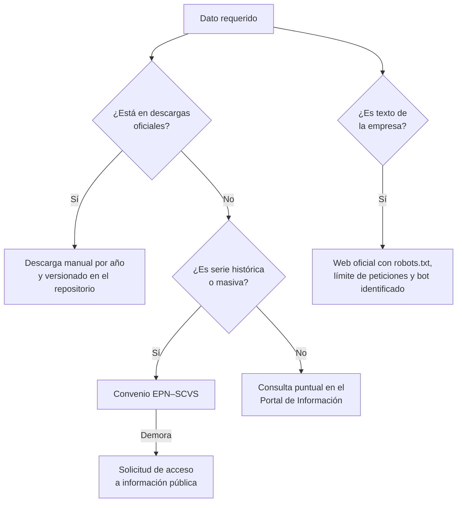

# 5. Adquisición de datos legal y ética

El portal de aplicaciones de la SCVS rechaza el acceso automatizado, por lo que se descarta el scraping masivo. Las cifras se obtienen por descargas oficiales y por vía institucional.

## Rutas de obtención

| Ruta | Para qué | Estado | Fuente |
| --- | --- | --- | --- |
| Descargas del Ranking | Cifras anuales por empresa y CIIU | Disponible | [SCVS – Ranking](https://appscvsmovil.supercias.gob.ec/ranking/reporte.html) |
| Directorio en Datos Abiertos | Universo de compañías | Disponible | [Datos Abiertos Ecuador](https://datosabiertos.gob.ec/dataset/directorio-de-companias) |
| Convenio EPN–SCVS | Serie histórica desde 2006 y bases completas | Por gestionar | Precedente: [convenio SCVS–Universidad Andina, feb-2026](https://www.supercias.gob.ec/portalscvs/Noticias/Noticias.php?seccion=noticia-26022026) |
| Solicitud de información pública | Plan B si el convenio tarda | Por gestionar | — |
| Scraping del portal SCVS | — | Descartado | Verificación propia (20-oct-2026): acceso automatizado rechazado por robots.txt de appscvsmovil.supercias.gob.ec |

## Reglas para sitios web de empresas

| Regla | Fundamento |
| --- | --- |
| Respetar robots.txt y términos de uso | Buenas prácticas de recolección web |
| Límite de peticiones y user-agent identificado como proyecto EPN | Trazabilidad y no afectación del sitio |
| Guardar solo texto institucional | Ley Orgánica de Protección de Datos Personales |
| Registrar URL, fecha de captura y hash del contenido | Citación y reproducibilidad (F_AA_233A) |
