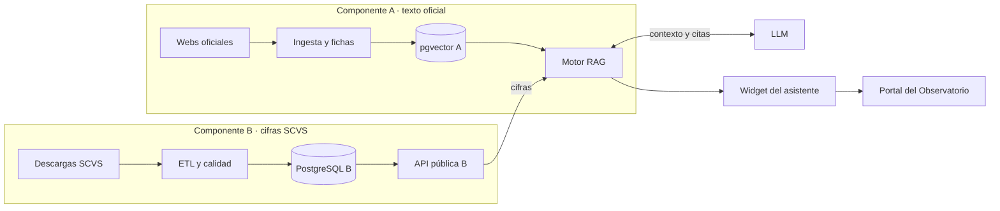

# 6. Arquitectura e integración

El Componente B publica las cifras por API. El Componente A indexa solo texto oficial y une ambas fuentes en el motor RAG. El asistente se entrega como widget embebible en el portal en curso.

Frontera A/B según el formulario del proyecto: B entrega una API pública documentada y A la consume como fuente (formulario F_AA_233A).

## Contratos a fijar

| Contrato | Contenido mínimo | Responsables |
| --- | --- | --- |
| A ↔ B | OpenAPI con `/empresas`, `/empresas/{expediente}`, `/indicadores?ciiu=&tamano=&anio=`; A no accede a la base de B | Pereira, Muzo |
| A ↔ portal | Widget embebible (web component o iframe) + API `/chat` | Pereira, equipo del portal |
| Repositorio | Monorepo único A+B: `/etl`, `/api`, `/rag`, `/widget`, `/docs` | Sugerencia del director |

## Alineación con FragUI (TIC de E. Armas, 2026)

El director pidió evitar el problema de integración que ocurrió cuando cada equipo usó distinta tecnología. FragUI es la librería de componentes ya construida en el mismo grupo de investigación; reutilizarla reduce ese riesgo.

| Aspecto FragUI | Implicación para el widget | Fuente |
| --- | --- | --- |
| React + TypeScript | Widget en React + TypeScript | TIC Armas, Tabla 1.1 |
| Componentes `Form`, `Field`, `InputText`, `Select` con validación y `FormApi` | Reutilizar para la caja de consulta y filtros (sector, tamaño, año) | TIC Armas, §2.1.3 |
| Punto de entrada único `src/index.ts` | Importar solo desde el paquete público | TIC Armas, §2.3.1.4 |
| Estilos en línea a partir de tokens; sin modo oscuro | Respetar tokens; no introducir otra librería de estilos | TIC Armas, §2.2.2 y §2.3.1.3 |
| Storybook + Vitest + Chromatic + axe-core (WCAG 2.1 AA) | Mismo flujo de documentación y pruebas para el widget | TIC Armas, §2.4–2.5 |
| Recomendación: probar contra un backend real (no json-server) | El asistente puede ser ese primer backend real | TIC Armas, §3.3 |
| Repositorio | [github.com/RodraHa/FragUI](https://github.com/RodraHa/FragUI) | TIC Armas, Anexo II |

## Pendientes con el equipo del portal

| Pregunta | Por qué importa |
| --- | --- |
| ¿Framework y versión de React del portal? | Compatibilidad del widget |
| ¿Usa FragUI como dependencia? | Reutilización directa de componentes |
| ¿Autenticación y dominio? | Configuración de CORS y sesión |
| ¿Despliegue final en EPN o AWS? | Ubicación del servicio `/chat` |
