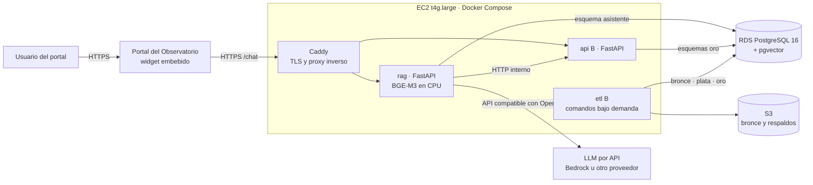

# 7. Infraestructura: propuesta definitiva

Corte: 03-nov-2026. Reemplaza la versión preliminar del 20-oct-2026.

Se propone desarrollar en local con Docker Compose y desplegar la misma composición en la cuenta AWS de la EPN: una instancia EC2 para los contenedores, una base RDS PostgreSQL con pgvector compartida con el Componente B, un bucket S3 y el LLM por API. No se requiere GPU: el LLM es un servicio externo y los embeddings BGE-M3 se calculan en CPU. El costo estimado es de USD 80–110 al mes, y se solicita un tope de USD 150 al mes. La decisión se registra en el [ADR 0008](../adr/0008-infraestructura-de-despliegue.md).

## Requisitos que condicionan la decisión

| Requisito | Origen |
| --- | --- |
| Desarrollo en los equipos de los estudiantes | Condición del proyecto |
| Despliegue en la infraestructura de la EPN (servidores propios o AWS), con pruebas de rendimiento y carga | Plan F_AA_234A, sprint 8 |
| Modelo de lenguaje de bajo costo, accedido por una interfaz compatible con la API de OpenAI y elegido por evaluación comparativa en el sprint 1 | Plan F_AA_234A; ADR 0004 |
| BGE-M3 como modelo de embeddings ejecutado localmente | Plan F_AA_234A |
| Evaluación con al menos 30 usuarios reales | Plan F_AA_234A, sprint 7 |
| Una sola base para A y B, con esquemas y roles separados | ADR 0002; [10](10-coherencia-con-componente-b.md) I4 |
| Despliegue portable: mismo artefacto en local, EPN o AWS | Coincidencia con B ([B-07](../investigacion-b/07-alternativa-aws.md)) |

## Arquitectura de despliegue



| Pieza | Elección | Motivo | Alternativa descartada |
| --- | --- | --- | --- |
| Cómputo | 1 EC2 `t4g.large` (2 vCPU ARM, 8 GiB) con Docker Compose | Mismo `docker-compose.yml` que en local; 8 GiB alcanzan para BGE-M3 (~2,3 GB) y las dos API | ECS Fargate: más piezas (ALB, definiciones de tarea) para un tráfico académico bajo; queda como vía de escalamiento |
| TLS y enrutamiento | Caddy en un contenedor | Certificados automáticos sin balanceador de pago | Application Load Balancer: costo fijo mensual sin necesidad |
| Base de datos | RDS PostgreSQL 16 `db.t4g.small` (2 vCPU, 2 GiB, 20 GB gp3) con pgvector | Respaldos automáticos y parches gestionados; el volumen previsto es pequeño | PostgreSQL dentro de la EC2: respaldos manuales y riesgo de pérdida |
| Archivos | S3 con versionado: `bronce/` (B), `corpus/` (A), `respaldos/` | Inmutabilidad y bajo costo | Disco de la EC2 |
| Embeddings | BGE-M3 en CPU dentro del contenedor `rag` | Fijado en el plan; sin costo por uso; reproducible | API de embeddings: dependencia externa sin ahorro relevante |
| LLM | Proveedor por API con interfaz compatible con OpenAI (sección siguiente) | Sin GPU; costo por uso bajo | Modelo autoalojado en EC2 con GPU: costo fijo superior a USD 300 al mes |
| Secretos | AWS Systems Manager Parameter Store (parámetros cifrados) | Sin costo en el nivel estándar | Archivos `.env` en el servidor |
| Control de costos | AWS Budgets con alertas al 50 %, 80 % y 100 % del tope | Evita sobrecostos | — |
| Región | `us-east-1` | Mayor catálogo de modelos en Bedrock y precios de referencia | `sa-east-1`: menor latencia, menos modelos y precios más altos |

Si la EPN decide desplegar en sus propios servidores, se conserva la misma composición: solo cambian el anfitrión de Docker Compose y la cadena de conexión a PostgreSQL. El LLM sigue siendo un servicio por API.

## Modelo de lenguaje por API

La aplicación usa el cliente `openai` con `base_url`, `api_key` y `model` definidos por variables de entorno (ADR 0004). Así, cambiar de proveedor es un cambio de configuración y no de código.

### Candidatos para la evaluación comparativa del sprint 1

| Modelo | Proveedor | Entrada (USD / 1M tokens) | Salida (USD / 1M tokens) | Facturación | Fuente |
| --- | --- | --- | --- | --- | --- |
| Amazon Nova Lite | Amazon Bedrock | 0,06 | 0,24 | Cuenta AWS de la EPN | [Avahi, lista de precios AWS us-east-1 del 30-sep-2026](https://avahi.ai/blog/aws-bedrock-pricing/) |
| GPT-6 Luna | OpenAI | 0,10 | 0,50 | Cuenta propia de OpenAI | [VentureBeat](https://venturebeat.com/technology/openai-releases-gpt-6-sol-and-luna-models-slashing-api-costs-50-or-more) |
| Gemini 3.1 Flash-Lite | Google | 0,25 | 1,50 | Cuenta propia de Google Cloud | [Google AI Studio – Pricing](https://aistudio.google.com/docs/pricing) |
| Gemini 3.5 Flash-Lite | Google | 0,30 | 2,50 | Cuenta propia de Google Cloud | [Google AI Studio – Pricing](https://aistudio.google.com/docs/pricing) |
| Claude Haiku 4.5 (referencia de calidad) | Amazon Bedrock | 1,00 | 5,00 | Cuenta AWS de la EPN | [Bacancy](https://www.bacancytechnology.com/blog/aws-bedrock-pricing) |

Los precios provienen de fuentes secundarias y de la página oficial de Google, consultadas el 03-nov-2026. Se verifican en las páginas oficiales antes de la solicitud formal.

### Criterios de selección

| Criterio | Peso | Medición |
| --- | --- | --- |
| Fidelidad de la respuesta al contexto | 35 % | RAGAS `faithfulness` sobre 50 preguntas de referencia |
| Pertinencia de la respuesta | 20 % | RAGAS `answer_relevancy` |
| Calidad en español y citación correcta | 15 % | Revisión manual de 20 respuestas con rúbrica |
| Costo mensual estimado | 15 % | Escenario de uso de la tabla siguiente |
| Latencia p95 | 10 % | Medición sobre las 50 preguntas |
| Facturación dentro de la cuenta AWS de la EPN | 5 % | Sí / no |

Regla de proveedor: el modelo ganador se consume por Amazon Bedrock cuando está disponible ahí, mediante su endpoint compatible con OpenAI ([AWS – Chat Completions en Bedrock](https://docs.aws.amazon.com/bedrock/latest/userguide/inference-chat-completions.html)). En caso contrario, se usa la API del proveedor con una cuenta institucional y un tope de gasto. Ningún dato de usuarios se envía a niveles gratuitos, porque Google declara que puede usar los datos del nivel gratuito para mejorar sus productos ([Google AI Studio – Pricing](https://aistudio.google.com/docs/pricing)).

### Estimación de uso y costo del LLM

| Supuesto | Valor |
| --- | --- |
| Tokens de entrada por consulta (instrucciones + 5 fragmentos + pregunta) | ~3.000 |
| Tokens de salida por consulta | ~400 |
| Consultas al mes en el pico (desarrollo, evaluación RAGAS con juez LLM y 30 usuarios) | 10.000 |
| Tokens al mes en el pico | 30 M de entrada y 4 M de salida |

| Modelo | Costo mensual en el pico (USD) |
| --- | --- |
| Amazon Nova Lite | 2,76 |
| GPT-6 Luna | 5,00 |
| Gemini 3.1 Flash-Lite | 13,50 |
| Gemini 3.5 Flash-Lite | 19,00 |
| Claude Haiku 4.5 | 50,00 |

## Dimensionamiento del corpus

| Variable | Valor |
| --- | --- |
| Empresas del piloto con documentos | ~500 (hasta 1.500) ([B-08](../investigacion-b/08-plan-y-negociacion.md)) |
| Documentos por empresa (portada, nosotros, servicios, un PDF) | ~4 |
| Fragmentos por documento | ~6 |
| Vectores del piloto | ~12.000 (hasta ~36.000), más los reportes del Observatorio |
| Dimensión BGE-M3 | 1.024 |
| Tamaño de vectores e índice HNSW | < 400 MB |
| Indexación inicial en CPU | Del orden de minutos a una hora; se ejecuta una vez por campaña |

## Costo mensual estimado en AWS (us-east-1, bajo demanda)

| Recurso | Configuración | USD / mes | Fuente |
| --- | --- | --- | --- |
| EC2 | `t4g.large` + 30 GB gp3 | ~52 | AWS Pricing Calculator (por verificar) |
| RDS PostgreSQL | `db.t4g.small`, Single-AZ, 20 GB gp3 | ~26 | [Bytebase – db.t4g.small](https://www.bytebase.com/dbcost/rds/instance/db.t4g.small/) |
| IPv4 pública | 1 dirección | ~4 | Tarifa de IPv4 pública de AWS |
| S3 + CloudWatch + Parameter Store | < 10 GB, registros básicos | ~3 | AWS Pricing Calculator (por verificar) |
| LLM | Pico de evaluación | 3–50 | Tabla anterior |
| **Total** | | **~88–135** | |

## Solicitud a la EPN

| Recurso | Cantidad | Compartido con B |
| --- | --- | --- |
| Instancia EC2 `t4g.large` con Docker | 1 | Sí |
| RDS PostgreSQL 16 con pgvector, `db.t4g.small` | 1 | Sí (esquemas y roles separados) |
| Bucket S3 con versionado | 1 | Sí (prefijos por componente) |
| Acceso a Amazon Bedrock (rol IAM y clave de API) en `us-east-1` | 1 | Sí (A para el asistente; B para textos `derivado`) |
| Subdominio con registro DNS hacia la EC2 | 1 | Sí |
| Presupuesto con alertas en AWS Budgets | Tope de USD 150 al mes | Sí |
| Usuarios IAM con mínimo privilegio | 2 estudiantes + director | Sí |

## Entorno local

| Servicio de `docker-compose.yml` | Imagen o comando | Puerto |
| --- | --- | --- |
| `postgres` | `pgvector/pgvector:pg16` | 5432 |
| `mock-b` | Prism sobre `contracts/openapi.yaml` | 4010 |
| `rag` | `uv run --directory rag uvicorn ...` | 8002 |
| `api` (B) | `uv run --directory api uvicorn ...` | 8001 |

En desarrollo, el LLM se consume con claves personales de bajo tope o con un modelo abierto mediante Ollama, ambos detrás de la misma interfaz compatible con OpenAI.

```powershell
$env:PG_PASS = Read-Host -Prompt "Clave Postgres"
docker run -d --name obs-pg -e POSTGRES_PASSWORD=$env:PG_PASS -p 5432:5432 pgvector/pgvector:pg16
docker exec -it obs-pg psql -U postgres -c "CREATE EXTENSION IF NOT EXISTS vector;"
```

## Vías de escalamiento

| Señal | Acción |
| --- | --- |
| Latencia p95 del asistente > 8 s por la base | Subir RDS a `db.t4g.medium` |
| CPU de la EC2 sostenida > 70 % en las pruebas de carga | Subir a `t4g.xlarge` o separar `rag` en ECS Fargate |
| Campañas de recolección largas de B | Tareas ECS Fargate bajo demanda ([B-07](../investigacion-b/07-alternativa-aws.md)) |
| Uso real superior a 10.000 consultas al mes | Caché de respuestas frecuentes y caché de prompts del proveedor |
