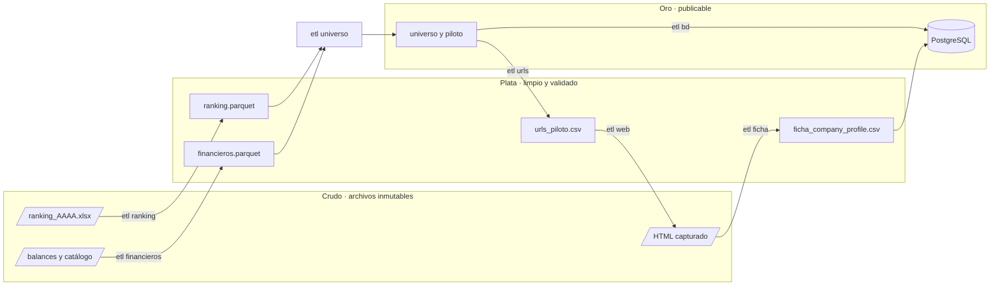

# etl · Componente B

Dueño: Eduardo Muzo. Lleva las descargas oficiales de la SCVS y las webs
oficiales de las empresas hasta los datos que publica la API: carga, calidad,
universo, Company Profile, indicadores y proyecciones.

- Modelo de datos y relaciones: [base-de-datos.md](base-de-datos.md)
- Universo y piloto: [docs/universo.md](../docs/universo.md)
- Campos de la ficha: [docs/ficha-empresa.md](../docs/ficha-empresa.md)

## El pipeline

Cada paso es un comando, recibe el año y es idempotente: repetirlo no duplica
filas ni vuelve a visitar las webs ya capturadas.



| Comando | Capa | Qué hace |
| --- | --- | --- |
| `etl ranking` | Crudo → Plata | Limpia el ranking, separa el CIIU, deriva el tamaño por ventas, marca el dato de empleados y valida con pandera |
| `etl financieros` | Crudo → Plata | Lee los estados financieros por ramo y conserva las cuentas de interés, entre ellas el gasto en sueldos |
| `etl universo` | Plata → Oro | Aplica la delimitación aprobada, arma el piloto y las listas top 50, y diagnostica el dato de empleados con la nómina |
| `etl urls` | Plata | Propone dominios a partir del nombre, descarta por DNS y verifica la portada |
| `etl web` | Crudo | Captura portada y páginas institucionales de las webs verificadas |
| `etl ficha` | Plata | Arma el Company Profile con la fuente de cada campo |
| `etl bd` | Oro | Carga en PostgreSQL |
| `etl todo` | — | Corre el pipeline completo del año |

```bash
uv sync                       # crea etl/.venv
uv run etl todo --anio 2025   # pipeline completo
uv run etl urls --anio 2025 --limite 25   # una tanda de 25 empresas por grupo
uv run pytest                 # 62 pruebas
uv run ruff check . && uv run ruff format --check .
```

Los pasos `urls` y `web` salen a internet y aceptan `--limite` para trabajar
por tandas. El resto corre sin red.

## Datos

```
datos/
├── crudo/      lo que llega de la fuente, nunca se edita
│   ├── AAAA/          descargas SCVS del año + MANIFEST.csv en la raíz
│   └── web/AAAA/      HTML capturado + manifest.jsonl
├── plata/AAAA/ limpio y validado
├── oro/AAAA/   listo para publicar
└── universo/   selección inicial del Componente A (09-nov-2026), sin cambios
```

En git van los manifiestos, los CSV y los reportes de calidad. No van los
Parquet ni el HTML, que se regeneran, ni los archivos de más de 100 MB, que se
recuperan con la URL del `MANIFEST.csv` y se verifican con su hash.

## Años cargados

| Año | Empresas limpias | Universo | Piloto | Estados financieros |
| --- | --- | --- | --- | --- |
| 2025 | 154.687 | 14.027 | 500 | Sí |
| 2024 | 142.519 | 12.931 | 478 | Pendiente de descargar |

El ranking está descargado desde 2010. Los estados financieros se bajan a mano
porque el formulario de la SCVS pide verificación humana.

## Stack

| Ámbito | Herramienta |
| --- | --- |
| Lenguaje y paquetes | Python 3.12, uv |
| Datos | pandas, python-calamine (Excel y ODS), pyarrow |
| Calidad | pandera |
| Recolección web | Scrapling en modo ético, trafilatura, extruct, rapidfuzz, pdfplumber |
| Base de datos | PostgreSQL 16, SQLAlchemy Core, psycopg 3 |
| Línea de comandos | Typer |
| Pruebas y lint | pytest, ruff |

## Recolección web

La configuración ética no es opcional: robots.txt obligatorio, bot
identificado como `ObservatorioEPN-Bot`, sin suplantar un navegador, una
petición por dominio cada tres segundos y sin reintentos si el sitio bloquea.
No se usan buscadores ni redes sociales, y no se guardan correos personales,
teléfonos personales ni cargos directivos.
