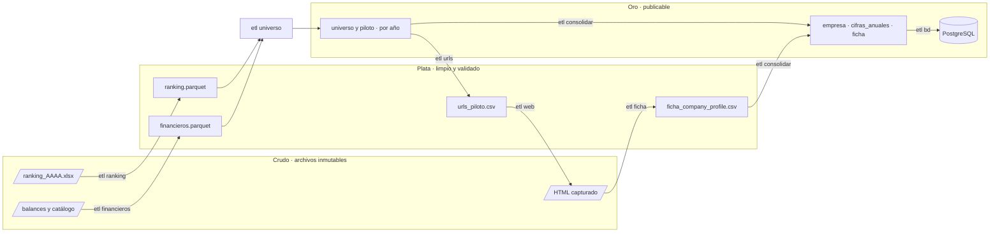

# etl · Componente B

Dueño: Eduardo Muzo. Lleva las descargas oficiales de la SCVS y las webs
oficiales de las empresas hasta los datos que publica la API: carga, calidad,
universo, Company Profile, indicadores y proyecciones.

- Cómo se construye y qué falta: [etl-guide.md](etl-guide.md)
- Modelo de datos y relaciones: [database.md](database.md)
- Qué hay de verdad en las tablas: [database-contents.md](database-contents.md)
- Universo y piloto: [docs/universo.md](../docs/universo.md)
- Campos de la ficha: [docs/ficha-empresa.md](../docs/ficha-empresa.md)

## El pipeline

Siete pasos por año, uno por comando, y dos pasos finales que juntan los años.
Cada paso es idempotente: repetirlo no duplica filas ni vuelve a visitar las
webs ya capturadas.



| Comando | Capa | Qué hace |
| --- | --- | --- |
| `etl ranking` | Crudo → Plata | Limpia el ranking, separa el CIIU, deriva el tamaño por ventas, marca el dato de empleados, manda a cuarentena las filas incoherentes y valida con pandera |
| `etl financieros` | Crudo → Plata | Lee los estados financieros por ramo y conserva las cuentas de interés, entre ellas el gasto en sueldos |
| `etl universo` | Plata → Oro | Aplica la delimitación aprobada, arma el piloto y las listas top 50, y diagnostica el dato de empleados con la nómina |
| `etl urls` | Plata | Propone dominios a partir del nombre, descarta por DNS y verifica la portada |
| `etl web` | Crudo | Lee el sitemap del sitio y captura la portada y las páginas institucionales que existen |
| `etl ficha` | Plata | Arma el Company Profile con la fuente de cada campo |
| `etl consolidar` | Oro | Junta la serie de los años con la forma de las tablas de la base, sobre el universo fijado en 2025 |
| `etl bd` | Oro | Carga en PostgreSQL lo que dejó `consolidar` |
| `etl verificar` | todas | Comprueba que todo cuadra: hashes, claves, filas y huérfanos. Falla si algo no cuadra |
| `etl documentar` | Oro | Escribe `database-contents.md` con el contenido real |
| `etl todo` | — | Corre el pipeline completo de un año, consolida y verifica |

```bash
uv sync                                   # crea etl/.venv e instala el paquete
uv run etl todo --anio 2025               # pipeline completo del año
uv run etl ranking --anio 2024            # un solo paso
uv run etl urls --anio 2025 --limite 25   # una tanda de 25 empresas por criterio
uv run etl consolidar                     # todos los años en una sola tabla
uv run etl verificar                      # 279 comprobaciones sobre lo que hay en disco
uv run pytest                             # 111 pruebas
uv run ruff check . && uv run ruff format --check .
```

`urls` y `web` consultan sitios externos y aceptan `--limite` para trabajar
por tandas. `etl bd` se conecta al PostgreSQL configurado. Consulta
[la guía de base de datos](database.md) para la conexión local.

## Datos

```
datos/
├── crudo/              lo que llega de la fuente, nunca se edita
│   ├── AAAA/               descargas SCVS del año + MANIFEST.csv en la raíz
│   └── web/AAAA/           HTML capturado + manifest.jsonl
├── plata/AAAA/         limpio y validado, una fila por empresa
│   ├── ranking.parquet
│   ├── descartes_ranking.csv    filas en cuarentena, con el motivo
│   ├── urls_piloto.csv
│   ├── plan_captura.csv         qué se le pidió a cada sitio y por qué
│   └── calidad_*.json
├── oro/
│   ├── AAAA/               universo, piloto y top 50 del año
│   ├── empresa.parquet          una fila por empresa
│   ├── cifras_anuales.parquet   una fila por empresa y ejercicio fiscal
│   └── ficha.csv
└── universo/           selección inicial del Componente A, sin cambios
```

En git van los manifiestos, los reportes de calidad y los CSV chicos: piloto,
top 50, URL, plan de captura y descartes. No van los Parquet, el HTML ni
`universo.csv` —que duplica el Parquet y son 51 MB en catorce años—, porque se
regeneran; tampoco los archivos de más de 100 MB, que se recuperan con la URL
del `MANIFEST.csv` y se verifican con su hash.

## Años

El ranking está descargado desde 2010 y los 16 años corren. Pero no todos
sirven: **la serie del Observatorio empieza en 2012**, por dos razones que
coinciden, la adopción de las NIIF y la cobertura de la fuente.

| Año | Empresas limpias | Universo | Piloto | Advertencia |
| --- | --- | --- | --- | --- |
| 2010 | 51.822 | 1.232 | 111 | 99 % de las cifras en cero: no utilizable |
| 2011 | 54.653 | 1.959 | 190 | 91 % de las cifras en cero: no utilizable |
| 2012–2013 | 41.778 · 46.753 | 5.149 · 5.697 | 316 · 337 | |
| 2014 | 52.105 | 6.083 | 332 | Sin ingreso total ni utilidad (98 % en cero) |
| 2015–2023 | 57.705 … 134.187 | 6.552 … 12.445 | 349 … 457 | |
| 2024 | 142.519 | 12.931 | 478 | Estados financieros pendientes de descargar |
| 2025 | 154.687 | 14.029 | 500 | |

**El universo se fija con el ranking 2025**, como dice
[docs/universo.md](../docs/universo.md): son 14.029 empresas y los otros años
aportan su serie de cifras, no empresas nuevas. El consolidado 2012–2025 tiene
118.803 filas de cifras, 8,5 años por empresa en promedio.

De esas 14.027 empresas, solo 4.623 aparecían en el ranking 2012 y 3.293
cumplían la delimitación ese año. La columna `en_universo_ese_anio` guarda ese
dato, que es material para la parte de evolución del Observatorio.

## Notebooks

Los notebooks **llaman al paquete**, no repiten su lógica: así muestran el
resultado y la evidencia sin desactualizarse cuando se corrige el código.

| Notebook | Qué muestra |
| --- | --- |
| `01_exploracion_ranking` | Procedencia por hash, estructura, duplicados, el caso de empleados y la cobertura de los 16 años |
| `02_crudo_a_plata` | El paso `ranking`, su reporte de calidad, la cuarentena y las marcas |
| `03_plata_a_oro` | El universo del año, la validación cruzada con el Componente A y el consolidado con su integridad referencial |
| `04_urls_oficiales` | Del nombre al dominio, el filtro DNS, el puntaje y lo que queda para revisión |
| `05_captura_web` | Las reglas de recolección, el sitemap, el plan y lo obtenido de cada empresa |
| `06_ficha_bloque2` | La ficha de cada empresa con la fuente de cada campo y las reglas de la LOPDP |

El kernel debe ser `etl/.venv`, que `uv sync` deja listo.

## Stack

| Ámbito | Herramienta |
| --- | --- |
| Lenguaje y paquetes | Python 3.12, uv |
| Datos | pandas, python-calamine (Excel y ODS), pyarrow |
| Calidad | pandera |
| Recolección web | Scrapling en modo ético, trafilatura, extruct, rapidfuzz, pdfplumber |
| Base de datos | PostgreSQL 16, SQLAlchemy Core, psycopg 3 |
| Línea de comandos | Typer |
| Pruebas y lint | pytest, ruff |

## Avance de la recolección web

Lo de la ficha es lo único que no se resuelve con una descarga: hay que
encontrar y verificar la web de cada empresa.

| | Empresas |
| --- | --- |
| Piloto | 500 |
| Con URL buscada | 105 |
| Verificadas | 26 |
| En revisión a mano | 45 |
| Sin web encontrada | 34 |
| Con ficha | 25 (11 completas, 12 parciales, 2 pendientes) |

De las 66 páginas capturadas, **63 salieron del sitemap**. Una empresa pidió
no ser archivada con `<meta name="robots">` y se respetó.

## Recolección web

El paso `web` primero le pregunta al sitio qué páginas tiene —su `robots.txt`
declara el sitemap— y solo después pide la portada y las páginas
institucionales que existen de verdad. Si no hay sitemap, y solo entonces,
sigue los enlaces de la portada.

La configuración ética no es opcional: `robots.txt` obligatorio y también la
etiqueta `<meta name="robots">` de cada página, bot identificado como
`ObservatorioEPN-Bot` con URL de contacto, sin suplantar un navegador, una
petición por dominio a la vez con pausa adaptativa desde 5 s, y se deja de
pedir ante 429, 503 o 403. No se usan buscadores ni redes sociales, y no se
guardan correos personales, teléfonos personales ni cargos directivos.
