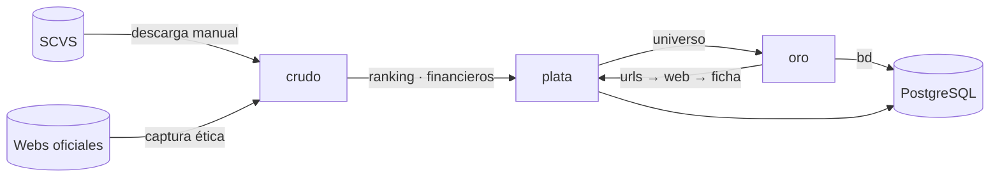

# Cómo se construye el ETL del Componente B

Esta guía responde dos preguntas: qué es un ETL y qué le falta al nuestro. No
es teoría suelta: cada regla viene con lo que ya cumplimos, lo que falta y en
qué archivo se arregla. Las fuentes están al final.

## 1. Qué es un ETL y por qué el nuestro es un pipeline

ETL son tres verbos: **extraer** de la fuente, **transformar** a una forma
usable y **cargar** donde se consulta. Un *script* hace los tres de corrido y
se rompe a la primera. Un **pipeline** los separa en pasos con una entrada y
una salida de archivo, de modo que cada paso se puede correr, repetir y
revisar solo.



Nuestros siete pasos (`etl ranking`, `financieros`, `universo`, `urls`, `web`,
`ficha`, `bd`) son eso. Lo que los vuelve un pipeline y no siete scripts son
las cinco reglas de la sección siguiente.

## 2. Las cinco reglas de un ETL serio

### 2.1 Idempotente: correrlo dos veces da lo mismo que una

Es la regla más importante y la que más se olvida. Si un paso falla a mitad y
lo repites, no debe duplicar ni perder filas. La forma estándar es escribir
con *upsert* (`INSERT ... ON CONFLICT DO UPDATE`) en vez de `INSERT`, y
reescribir la partición completa en vez de agregarle filas.

| | |
| --- | --- |
| Cumplido | Los Parquet se reescriben por año; `etl bd` usa `ON CONFLICT DO UPDATE`; `urls` y `web` no revisitan lo ya cerrado |
| Falta | Nada en los pasos de archivo. En la base falta la clave única de `documento` cuando una misma página cambia de contenido |

### 2.2 Incremental y por año, con ventana de solape

Reprocesar todo cada vez es caro y acaba en que nadie lo corre. Se procesa el
tramo nuevo. El riesgo conocido es perder filas que la fuente publicó tarde,
así que se vuelve a leer una ventana pequeña hacia atrás; como la escritura es
idempotente, el solape no duplica nada. El relleno histórico (*backfill*) debe
correr **por el mismo camino** que el día a día, solo cambiando el parámetro
de fecha, para que no existan dos versiones de la verdad.

| | |
| --- | --- |
| Cumplido | `--anio` es ese parámetro: `etl todo --anio 2024` rellena historia por el mismo camino que `2025` |
| Falta | Correr los años 2010–2023 que ya están descargados; una tabla de qué año se procesó cuándo |

### 2.3 Trazable: de cada dato se sabe de dónde salió

Un dato sin procedencia no sirve para una tesis ni para un portal de datos
abiertos. Se guarda el archivo original intacto, su hash y su URL de origen; y
en cada campo redactado, la URL y la fecha de la que salió.

| | |
| --- | --- |
| Cumplido | `datos/crudo/MANIFEST.csv` con hash SHA-256; `manifest.jsonl` de cada captura web; columnas `*_fuente` en la ficha |
| Falta | `url_origen` vacía en varias filas del MANIFEST; no hay registro de corridas (quién corrió qué paso, cuándo, cuántas filas) |

### 2.4 Validado: el paso falla antes de escribir basura

La validación no es un informe que nadie lee: es una condición que detiene el
paso. Se mide en la capa plata, y es lo que separa una capa plata confiable de
una copia con otro nombre.

| | |
| --- | --- |
| Cumplido | Esquema pandera en `ranking` y en `ficha`; **cuarentena** con el motivo en `descartes_ranking.csv`; el reporte cuadra filas crudas, descartadas y de plata; 97 pruebas |
| Falta | Validar `financieros` y `universo` con esquema propio |

### 2.5 Reproducible: otro lo corre y obtiene lo mismo

Versiones de librerías fijadas, sin rutas absolutas, sin pasos manuales no
documentados y con el lint y las pruebas en CI.

| | |
| --- | --- |
| Cumplido | `uv.lock`; rutas relativas en `config.py`; CI con ruff, pytest y una carga contra PostgreSQL; los seis notebooks corren de principio a fin |
| Falta | Fijar la versión del kernel de los notebooks en CI |

## 3. Las tres capas (Medallion), según el manual

Databricks define las capas así, y conviene seguirlo al pie porque el error
típico —escribir datos ya limpios directo en plata— deja sin forma de
reprocesar cuando aparece un error en la limpieza.

| Capa | Qué contiene, según la definición | Cómo lo aplicamos |
| --- | --- | --- |
| **Crudo** (bronce) | «datos crudos, sin validar», en su formato original, solo se le agregan filas | `datos/crudo/AAAA/`: los XLSX y TXT de la SCVS y el HTML capturado, nunca editados |
| **Plata** | «versiones validadas, limpias y enriquecidas»; siempre al menos una representación **no agregada** de cada registro | `ranking.parquet`, `financieros.parquet`, `urls_piloto.csv`, `ficha_company_profile.csv`: una fila por empresa |
| **Oro** | conjuntos con sentido de negocio, agregados y filtrados, optimizados para consulta | `universo.parquet`, `piloto.csv`, `top50_*.csv` |

Dos consecuencias prácticas para nosotros:

1. **El HTML crudo no se borra nunca.** Si mañana mejoramos el extractor de
   descripciones, se vuelve a correr `etl ficha` sobre el HTML ya guardado, sin
   volver a molestar a ninguna web.
2. **Oro ya no es plata con otro filtro.** `etl consolidar` hace el giro de
   «un archivo por año» a «una fila por empresa con su serie», que es la forma
   en que la API va a consultar. Lo que todavía falta en oro son los
   agregados: empresas por grupo y año, ventas totales, mediana de ventas por
   empleado. Son material de oro y son justo lo que el portal va a graficar.

## 4. Web scraping: las reglas y lo que nos falta

AWS publica una guía de crawlers éticos que es la referencia más clara, y hay
un borrador del IETF sobre bots de recolección de datos. Esto es lo que dicen
y cómo estamos:

| Regla | Fuente | Nosotros |
| --- | --- | --- |
| Respetar `robots.txt`, revisando las reglas del agente de escritorio y del móvil | AWS | Sí, `robots_txt_obey=True`; falta revisar el agente móvil |
| Identificar el bot en el `User-Agent`, con contacto | AWS | Sí: `ObservatorioEPN-Bot/0.1 (+URL del repo)` |
| Ritmo razonable: 1 petición cada 10–15 s en sitios chicos o medianos | AWS | Pausa adaptativa desde 5 s, que se alarga sola hasta 60 s si el servidor tarda |
| Usar el **sitemap** para encontrar las páginas que importan | AWS | Sí: la fase 1 del paso `web` lee `robots.txt` y el sitemap |
| Pausar en 429 y dejar de insistir ante 403 repetidos | AWS | Sí: 429 y 503 detienen el dominio, y un 403 lo descarta |
| Revisar las `meta` del HTML por directivas de rastreo | AWS | Sí: si la página pide `noindex` o `noarchive`, no se guarda su HTML |
| Trabajar en lotes, no todo de golpe | AWS | Sí, `--limite` |
| Guardar registro de la actividad de recolección | Bright Data | Sí, `manifest.jsonl` |
| Revisar los términos de servicio del sitio | AWS | Falta dejarlo escrito por empresa |

El sitemap fue el cambio que más rindió. En Telconet, por ejemplo, el sitemap
entregó `/nosotros/`, `/soluciones/` y `/contactenos/` sin una sola petición
perdida; adivinando, esas tres rutas no se habrían acertado. La elección es
una página por tema, para que una empresa no gaste sus tres peticiones en tres
páginas de productos.

Lo que **no** se hace, y queda escrito: no se suplanta un navegador, no se
usan buscadores ni redes sociales, no se guardan correos personales, teléfonos
personales ni cargos directivos (LOPDP).

## 5. Notebooks o módulo: las dos cosas, sin duplicar lógica

La misma función existía dos veces, en el notebook y en el módulo. Por eso los
notebooks quedaron desactualizados y dejaron de correr. Duplicar era el
problema, no el notebook.

Ya está resuelto: los seis notebooks importan del paquete y se quedan con las
celdas que miran el resultado. La separación que se sostiene:

| | Notebook | Módulo `src/etl/` |
| --- | --- | --- |
| Para qué | Explorar, mostrar evidencia, graficar, decidir un umbral | Correr el pipeline, por año, en CI, sin supervisión |
| Qué contiene | `from etl.pasos import urls` y celdas que miran el resultado | La lógica, una sola vez, con pruebas |
| Quién lo lee | El profesor y la tesis | La máquina |

Así se trabaja en los mismos notebooks, pero la lógica vive en un solo lugar:
si se corrige el extractor, se corrige para el notebook y para la corrida de
producción a la vez.

Y sirvió de inmediato: correr los seis de punta a punta destapó dos errores
reales que las pruebas no cubrían, los dos por lo mismo. En un DataFrame una
celda vacía es `NaN`, que es un float **verdadero**: `NaN or []` devuelve
`NaN` y `list(NaN)` falla. Pasaba en cuanto el manifiesto mezclaba páginas
capturadas con páginas omitidas. Hoy está encapsulado en `ficha.lista()`, con
prueba de regresión.

## 6. Cómo se corre por años

```bash
cd etl
uv sync                                   # .venv propio de etl
uv run etl todo --anio 2025               # pipeline completo del año
uv run etl ranking --anio 2024            # un solo paso
for a in $(seq 2012 2025); do uv run etl ranking --anio $a; done   # relleno
uv run etl consolidar                     # todos los años en una sola tabla
```

Los pasos `urls` y `web` son los únicos que salen a internet y aceptan
`--limite` para ir por tandas. El resto corre sin red.

Los 16 años corren, pero no todos sirven. Esto salió de correrlos:

| Año | Cifras en cero | Veredicto |
| --- | --- | --- |
| 2010 | 99 % de activo, patrimonio, ventas, utilidad e ingreso | No utilizable: la SCVS publicó solo la identificación |
| 2011 | 91–94 % de las mismas columnas | No utilizable |
| 2014 | 98 % de ingreso total y utilidad | Ventas y activo sí; ingreso y utilidad **no se pueden usar** |
| 2012–2025 | 27–40 % de ventas, que son empresas inactivas | Utilizable |

Por eso `config.ANIO_MINIMO_COMPARABLE = 2012`, que coincide con la adopción
de las NIIF, y `COBERTURA_MINIMA_VENTAS` hace que el paso `universo` avise
cuando un año no alcanza. La marca `ingreso_total_no_reportado` distingue
«no reportado» de «cero», que es lo que evita que un promedio de 2014 salga
mal.

## 7. Qué sigue después del ETL

El orden importa: cada etapa necesita que la anterior esté estable.

| Orden | Etapa | Está listo cuando | Estado |
| --- | --- | --- | --- |
| 1 | **ETL por año** | Los 16 años corren sin intervención y cada fila descartada tiene motivo | Hecho |
| 2 | **Consolidado** | Una fila por empresa con su serie, con integridad referencial comprobada | Hecho |
| 3 | **Scraping a escala** | Las 500 del piloto con URL resuelta y las verificadas con ficha | 19 de 500 |
| 4 | **Indicadores en oro** | Agregados por grupo y año listos para el portal | Pendiente |
| 5 | **Base de datos** | `etl bd` carga el consolidado y las consultas responden rápido ([base-de-datos.md](base-de-datos.md)) | Esquema escrito |
| 6 | **Contrato** | `contracts/openapi.yaml` revisado por el Componente A, que lo necesita para su servidor simulado | Pendiente |
| 7 | **API** | FastAPI implementa las rutas del contrato leyendo solo la capa oro | Pendiente |
| 8 | **Portal** | Decidido CKAN, propio o híbrido, con su ADR | Pendiente |

Las etapas 6 a 8 no se empiezan antes de la 5: una API sobre datos que todavía
cambian de forma se reescribe dos veces.

## 8. Una decisión pendiente: `bi_ranking.csv`

Entre las descargas ya hechas está `datos/crudo/2025/bi_ranking.csv`, y resultó
ser mucho más de lo que parecía: **1.677.347 filas, de 2008 a 2025, con 307.991
empresas y 34 indicadores financieros ya calculados por la SCVS** —liquidez
corriente, prueba ácida, endeudamiento, rotación, márgenes, ROE, ROA— más
costo de ventas, gastos financieros, gastos de administración y
depreciaciones. El 55 % de las filas trae los indicadores: son las empresas
que presentaron estados financieros.

Qué cambiaría si lo usamos:

| Hoy | Con `bi_ranking.csv` |
| --- | --- |
| 16 archivos XLSX, uno por año | Un solo archivo con la serie completa |
| Los estados financieros se bajan a mano y el formulario pide verificación humana; solo tenemos 2025 | Cuentas de resultados de 2008 a 2025, sin descargas manuales |
| Los indicadores habría que calcularlos nosotros | Vienen calculados por la fuente, lo que es más defendible en la tesis |

Conviene decidirlo antes de seguir: si entra, el paso `financieros` se
simplifica mucho y `cifras_anuales` se arma de una sola fuente en vez de 16.
Lo que hay que comprobar primero es que sus cifras coincidan con las del
ranking año por año, porque si no coinciden hay que explicar cuál manda.

## Fuentes

- [What is the medallion lakehouse architecture?](https://docs.databricks.com/aws/en/lakehouse/medallion.html) — Databricks. Definición de las capas crudo, plata y oro.
- [Data pipeline best practices](https://databricks.com/blog/data-pipeline-best-practices) — Databricks. Carga incremental y escrituras idempotentes.
- [What is idempotency in data pipelines?](https://beetroot.co/glossary/devops/what-is-idempotency-in-data-pipelines/) — Beetroot. La idempotencia cubre también los efectos secundarios, no solo la transformación.
- [ETL best practices](https://www.ibm.com/think/insights/etl-best-practices) — IBM. Los reintentos son la causa típica de filas duplicadas.
- [Best practices for ethical web crawlers](https://docs.aws.amazon.com/prescriptive-guidance/latest/web-crawling-system-esg-data/best-practices.html) — AWS. robots.txt, ritmo de rastreo, sitemap, manejo de 429 y 403, lotes.
- [Web bot data collection](https://datatracker.ietf.org/doc/draft-farzdusa-webbot-datacollection/) — borrador IETF, marzo 2026. Estado del debate sobre robots.txt; es un borrador, no un estándar.
- [Ethical web scraping](https://docs.brightdata.com/scraping-automation/concepts/ethical-web-scraping) — Bright Data. Guardar registro de la actividad de recolección.
- [dbt data quality testing](https://www.datadoghq.com/blog/dbt-data-quality-testing.md) — Datadog. Pruebas de unicidad, nulos, valores aceptados y relaciones.
