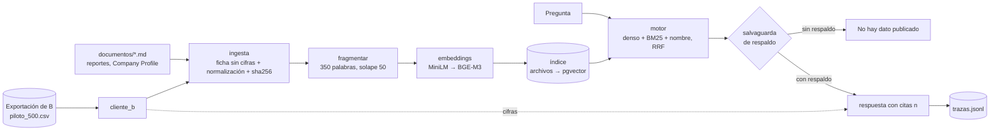

# rag · Componente A

Dueña: Alicia Pereira. Ingesta e indexación de texto oficial de empresas, motor RAG con citación, salvaguardas, trazabilidad y API `/chat`.

## Estado: prototipo funcional (09-nov-2026)

El prototipo recorre el flujo completo sobre las 500 empresas del piloto: ingesta → fragmentación → embeddings → índice → recuperación híbrida → respuesta con cita → traza. Resultados y hallazgos en [`evidencias/`](evidencias/README.md).



| Pieza | Archivo | Estado |
| --- | --- | --- |
| Cliente de B (simulado con la exportación CSV) | [`src/rag/cliente_b/`](src/rag/cliente_b/__init__.py) | Hecho; `ClienteBHttp` en el Sprint 6 |
| Ingesta: ficha de identificación y documentos Markdown con metadatos | [`src/rag/ingesta/`](src/rag/ingesta/__init__.py) | Hecho |
| Fragmentación, embeddings y almacén | [`src/rag/indice/`](src/rag/indice/__init__.py) | Hecho con almacén en archivos; pgvector pendiente |
| Pipeline idempotente (por hash) con registro de corridas | [`src/rag/pipeline.py`](src/rag/pipeline.py) | Hecho |
| Motor: recuperación híbrida, salvaguarda, cifras desde B, LLM opcional | [`src/rag/motor/`](src/rag/motor/__init__.py) | Hecho; falta elegir el LLM |
| Traza por respuesta | `rag/datos/trazas.jsonl` | Hecho; tabla `asistente.traza` pendiente |
| Evaluación de recuperación | [`src/rag/evaluacion.py`](src/rag/evaluacion.py), [`evaluacion/preguntas_prototipo.json`](evaluacion/preguntas_prototipo.json) | 30 preguntas; RAGAS en el Sprint 3 |
| API `/chat` (FastAPI) | `src/rag/api` | Pendiente (Sprint 3) |

### Decisiones del prototipo

| Decisión | Motivo |
| --- | --- |
| La ficha indexada no contiene cifras | Salvaguarda "cifras solo de la API de B": las ventas y los empleados se piden a B al responder |
| Ficha marcada `origen: derivado` | Se redacta a partir de campos oficiales de la SCVS, no se copia de una web |
| Índice en archivos (`vectores.npy`, `fragmentos.jsonl`) | Docker no estaba disponible en el equipo de desarrollo; la interfaz `Almacen` es la que implementará pgvector |
| Modelo MiniLM multilingüe en lugar de BGE-M3 | Ya estaba en caché local (118 MB frente a ~2,2 GB); se cambia con `RAG_EMBEDDINGS=BAAI/bge-m3` |
| Sin dependencia de LlamaIndex todavía | El prototipo hace visible cada etapa para la memoria; LlamaIndex se evalúa al integrar pgvector |
| LLM por HTTP compatible con OpenAI y respuesta descartada si no cita | ADR 0004; una respuesta sin citas válidas no llega al usuario |

## Uso

Desde la raíz del repositorio, con Python 3.12 y `numpy` + `sentence-transformers`:

```powershell
$env:PYTHONPATH = "rag/src"
python -m rag ingesta                    # idempotente; --reconstruir para empezar de cero
python -m rag consulta "¿Qué empresas desarrollan software en Cuenca?"
python -m rag consulta "¿Cuánto vendió Tiendas Tuti?" --json
python -m rag evaluar --salida rag/evidencias/eval.json
cd rag; python -m pytest -q              # 10 pruebas, sin descargar modelos
```

| Variable | Defecto | Para qué |
| --- | --- | --- |
| `RAG_EMBEDDINGS` | `sentence-transformers/paraphrase-multilingual-MiniLM-L12-v2` | Modelo; `hash-512` para pruebas sin modelo |
| `RAG_UMBRAL_SIMILITUD` / `RAG_UMBRAL_FUERTE` | 0,30 / 0,65 | Salvaguarda de respaldo |
| `RAG_TOP_K` | 5 | Fragmentos por respuesta |
| `RAG_LLM_BASE_URL`, `RAG_LLM_MODELO`, `RAG_LLM_API_KEY` | vacío | Activan la generación con LLM |
| `RAG_FUENTE_EMPRESAS` | `etl/datos/universo/2025/piloto_500.csv` | Exportación de B usada como API simulada |

## Estructura prevista

| Carpeta | Propósito |
| --- | --- |
| `datos/documentos/` | Documentos Markdown con metadatos (reportes del Observatorio, Company Profile) |
| `datos/indice/` | Índice generado (no se versiona) |
| `src/rag/ingesta` | Normalización y procedencia (URL, fecha, hash) |
| `src/rag/indice` | Fragmentación, embeddings, almacén (archivos → pgvector) |
| `src/rag/motor` | Recuperación y generación con citas |
| `src/rag/salvaguardas` | Se separa del motor cuando crezca (filtros de contenido, verificación de fidelidad) |
| `src/rag/cliente_b` | Cliente de la API de B (nunca la base de B) |
| `src/rag/api` | FastAPI: `/chat` y `/salud` |
| `migraciones/` | Alembic del esquema `asistente` |
| `evaluacion/` | Preguntas de referencia y resultados |
| `evidencias/` | Resultados versionados para la memoria |
| `tests/` | pytest; embeddings deterministas y LLM simulado |

## Stack

| Ámbito | Herramienta | Origen |
| --- | --- | --- |
| Lenguaje / API | Python 3.12 · FastAPI | Plan F_AA_234A |
| Paquetes | uv ([`pyproject.toml`](pyproject.toml)) | ADR 0001 |
| Base vectorial | PostgreSQL + pgvector, esquema `asistente` | ADR 0002 |
| LLM | Cliente compatible con OpenAI, configurado por variables de entorno | ADR 0004 |
| Pruebas / lint | pytest / ruff | — |
